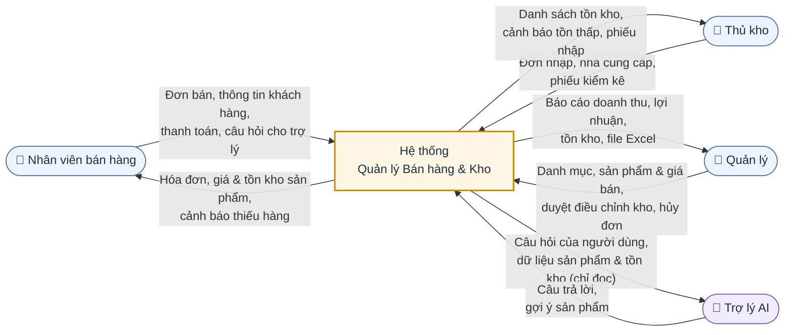

# Đặc tả yêu cầu phần mềm (SRS)
# Hệ thống Quản lý Bán hàng & Kho

| Thông tin | Giá trị |
|---|---|
| Phiên bản tài liệu | 1.1 (mở rộng module Bán hàng: FR-BAN-01 – FR-BAN-22) |
| Ngày lập | 28/10/2026 |
| Loại tài liệu | Đặc tả yêu cầu phần mềm (Software Requirements Specification) |
| Phạm vi áp dụng | Đồ án tốt nghiệp CNTT |

---

## 1. Giới thiệu và mục tiêu

### 1.1. Mục đích tài liệu

Tài liệu này đặc tả các yêu cầu chức năng và phi chức năng của **Hệ thống Quản lý Bán hàng & Kho** (sau đây gọi là "Hệ thống"). Đây là căn cứ cho các bước thiết kế, cài đặt, kiểm thử và nghiệm thu. Thiết kế cơ sở dữ liệu và kiến trúc chi tiết được trình bày ở tài liệu riêng.

### 1.2. Bối cảnh

Các cửa hàng bán lẻ vừa và nhỏ thường quản lý hàng hóa bằng sổ sách hoặc bảng tính. Cách làm này dẫn tới sai lệch tồn kho, khó tra cứu lịch sử nhập/bán, và chủ cửa hàng không có số liệu doanh thu kịp thời. Hệ thống được xây dựng để tin học hóa toàn bộ quy trình từ nhập hàng, quản lý kho đến bán hàng và báo cáo, kèm một trợ lý AI hỗ trợ nhân viên bán hàng.

### 1.3. Mục tiêu

| Mã | Mục tiêu | Chỉ số đo lường |
|---|---|---|
| MT-01 | Quản lý tập trung danh mục, sản phẩm, nhà cung cấp, khách hàng | 100% dữ liệu danh mục được lưu và tra cứu trên Hệ thống |
| MT-02 | Tồn kho luôn chính xác theo thời gian thực | Tồn kho được cập nhật ngay khi đơn nhập/đơn bán được xác nhận; sai lệch so với kiểm kê = 0 khi không có thất thoát vật lý |
| MT-03 | Rút ngắn thời gian lập đơn bán tại quầy | Lập một đơn bán 5 dòng hàng trong ≤ 60 giây |
| MT-04 | Cung cấp báo cáo doanh thu, lợi nhuận, tồn kho tức thời | Báo cáo theo ngày/tháng hiển thị trong ≤ 5 giây |
| MT-05 | Hỗ trợ nhân viên tư vấn bằng trợ lý AI | Trợ lý trả lời câu hỏi về sản phẩm dựa trên dữ liệu thực của cửa hàng |

### 1.4. Thuật ngữ và từ viết tắt

| Thuật ngữ | Giải thích |
|---|---|
| SKU | Mã định danh duy nhất của một sản phẩm (Stock Keeping Unit) |
| Đơn nhập | Phiếu ghi nhận hàng nhập từ nhà cung cấp vào kho |
| Đơn bán | Hóa đơn bán hàng cho khách |
| Tồn kho | Số lượng sản phẩm hiện có trong kho |
| Ngưỡng tồn tối thiểu | Số lượng mà khi tồn kho xuống bằng hoặc thấp hơn thì Hệ thống cảnh báo |
| Giá vốn | Giá nhập bình quân gia quyền của sản phẩm |
| RBAC | Phân quyền dựa trên vai trò (Role-Based Access Control) |
| JWT | JSON Web Token, dùng cho xác thực API |
| LLM | Mô hình ngôn ngữ lớn, nền tảng của trợ lý AI |

---

## 2. Phạm vi

### 2.1. Trong phạm vi

1. Xác thực người dùng, quản lý tài khoản và phân quyền theo vai trò.
2. Quản lý danh mục sản phẩm (phân cấp tối đa 2 cấp).
3. Quản lý sản phẩm: thông tin, giá bán, ảnh, ngưỡng tồn tối thiểu.
4. Quản lý nhà cung cấp.
5. Quản lý khách hàng và lịch sử mua hàng.
6. Quản lý đơn nhập hàng và cập nhật tồn kho khi nhập.
7. Quản lý đơn bán hàng tại quầy, in hóa đơn, cập nhật tồn kho khi bán.
8. Quản lý tồn kho: tra cứu, cảnh báo tồn thấp, kiểm kê và điều chỉnh, lịch sử biến động.
9. Báo cáo doanh thu, lợi nhuận gộp, sản phẩm bán chạy, tồn kho; xuất Excel.
10. Trợ lý AI bán hàng: hỏi đáp về sản phẩm, gợi ý sản phẩm, tra cứu tồn kho bằng ngôn ngữ tự nhiên.
11. Giao diện web (Blazor) cho người dùng nội bộ và Web API (ASP.NET Core) có tài liệu Swagger.

### 2.2. Ngoài phạm vi

1. Bán hàng trực tuyến cho khách hàng cuối (website thương mại điện tử, giỏ hàng online).
2. Tích hợp cổng thanh toán trực tuyến (VNPay, MoMo…) và xử lý thẻ ngân hàng.
3. Quản lý nhiều kho / nhiều chi nhánh.
4. Kế toán tổng hợp, sổ cái, xuất hóa đơn điện tử theo quy định của cơ quan thuế.
5. Quản lý nhân sự, chấm công, tính lương.
6. Ứng dụng di động native (iOS/Android).
7. Tích hợp phần cứng ngoài máy in hóa đơn qua trình duyệt (máy quét mã vạch chỉ hỗ trợ ở chế độ giả lập bàn phím).
8. Chương trình khách hàng thân thiết, tích điểm, khuyến mãi phức tạp (mua X tặng Y, combo).

---

## 3. Các bên liên quan và vai trò người dùng

### 3.1. Các bên liên quan

| Bên liên quan | Mối quan tâm |
|---|---|
| Chủ cửa hàng | Doanh thu, lợi nhuận, kiểm soát thất thoát, chi phí vận hành |
| Nhân viên cửa hàng | Thao tác nhanh, dễ học, ít sai sót |
| Khách hàng mua lẻ | Thanh toán nhanh, hóa đơn chính xác (không trực tiếp sử dụng Hệ thống) |
| Nhà cung cấp | Thông tin đơn nhập chính xác (không trực tiếp sử dụng Hệ thống) |
| Giảng viên hướng dẫn / Hội đồng | Tính đầy đủ, đúng đắn và khả năng kiểm chứng của sản phẩm |
| Nhóm phát triển | Yêu cầu rõ ràng, kiểm thử được |

### 3.2. Vai trò người dùng

| Vai trò | Mô tả | Quyền chính |
|---|---|---|
| Quản trị viên / Quản lý cửa hàng (`Admin`) | Chủ cửa hàng, người được ủy quyền, hoặc người quản lý kỹ thuật Hệ thống | Toàn quyền: quản lý tài khoản, phân quyền, cấu hình Hệ thống và trợ lý AI; toàn bộ nghiệp vụ; xem mọi báo cáo; duyệt điều chỉnh tồn kho; hủy đơn đã xác nhận; xem giá vốn và lợi nhuận |
| Nhân viên bán hàng (`SalesStaff`) | Nhân viên đứng quầy | Lập đơn bán, quản lý khách hàng, tra cứu sản phẩm và tồn kho, sử dụng trợ lý AI; **không** xem giá vốn, lợi nhuận |
| Quản lý kho (`WarehouseManager`) | Nhân viên phụ trách hàng hóa | Lập đơn nhập, quản lý nhà cung cấp, kiểm kê, đề xuất điều chỉnh tồn kho, tra cứu sản phẩm |

Hệ thống có đúng 3 vai trò, tên dùng trong code và JWT claim phân biệt hoa/thường: `"Admin"`, `"WarehouseManager"`, `"SalesStaff"`. Bản SRS trước có thêm vai trò "Quản lý cửa hàng (Admin)"; vai trò này đã được gộp vào `Admin` vì quyền của nó là tập con của quyền Admin. Trợ lý AI là một tính năng, không phải vai trò.

Ma trận quyền tóm tắt (C = tạo, R = xem, U = sửa, D = xóa/ngừng, A = duyệt/hủy):

| Chức năng | Admin | SalesStaff | WarehouseManager |
|---|---|---|---|
| Tài khoản người dùng | CRUD | – | – |
| Danh mục, sản phẩm | CRUD | R | R |
| Nhà cung cấp | CRUD | – | CRU |
| Khách hàng | CRUD | CRU | – |
| Đơn nhập | CRUDA | – | CRU |
| Đơn bán | CRUDA | CRU | – |
| Tồn kho, kiểm kê | CRUDA | R | CRU |
| Báo cáo | R | R (doanh thu ca của mình) | R (tồn kho) |
| Trợ lý AI | R + cấu hình | R | R |

---

## 4. Yêu cầu chức năng

Quy ước: mỗi yêu cầu có mã duy nhất FR-xx. Độ ưu tiên: **Cao** (bắt buộc cho bản nghiệm thu), **TB** (nên có), **Thấp** (có thì tốt).

### 4.1. Module Xác thực và Phân quyền (AUTH)

| Mã | Yêu cầu | Ưu tiên |
|---|---|---|
| FR-01 | Hệ thống cho phép người dùng đăng nhập bằng tên đăng nhập và mật khẩu. Đăng nhập thành công trả về JWT có hiệu lực 60 phút kèm refresh token có hiệu lực 7 ngày. | Cao |
| FR-02 | Sau 5 lần đăng nhập sai liên tiếp, tài khoản bị khóa 15 phút; Hệ thống hiển thị thông báo "Tài khoản tạm khóa" và thời điểm mở khóa. | Cao |
| FR-03 | Admin tạo, sửa, vô hiệu hóa tài khoản và gán đúng một vai trò trong 4 vai trò ở mục 3.2. Tài khoản bị vô hiệu hóa không đăng nhập được và mọi token hiện có bị từ chối ở lần gọi API kế tiếp. | Cao |
| FR-04 | Mọi API nghiệp vụ kiểm tra quyền theo ma trận ở mục 3.2; truy cập trái quyền trả về HTTP 403 và giao diện ẩn các chức năng mà vai trò không có quyền. | Cao |
| FR-05 | Người dùng tự đổi mật khẩu khi nhập đúng mật khẩu hiện tại; mật khẩu mới dài ≥ 8 ký tự, có ít nhất 1 chữ hoa, 1 chữ thường và 1 chữ số. | TB |
| FR-06 | Người dùng đăng xuất; refresh token bị thu hồi và không thể dùng để lấy token mới. | TB |

### 4.2. Module Danh mục (CAT)

| Mã | Yêu cầu | Ưu tiên |
|---|---|---|
| FR-07 | Admin tạo danh mục với tên (bắt buộc, 2–100 ký tự, không trùng trong cùng danh mục cha), mô tả (tùy chọn) và danh mục cha (tùy chọn, tối đa 2 cấp). | Cao |
| FR-08 | Admin sửa tên, mô tả, danh mục cha của danh mục; Hệ thống từ chối nếu thao tác tạo ra cấu trúc quá 2 cấp hoặc vòng lặp. | Cao |
| FR-09 | Hệ thống không cho xóa danh mục đang có sản phẩm hoặc danh mục con; trả về thông báo nêu rõ số sản phẩm/danh mục con đang liên kết. | Cao |
| FR-10 | Hệ thống hiển thị danh mục dạng cây kèm số sản phẩm đang kinh doanh trong mỗi danh mục. | TB |

### 4.3. Module Sản phẩm (PRD)

| Mã | Yêu cầu | Ưu tiên |
|---|---|---|
| FR-11 | Admin tạo sản phẩm với: SKU (bắt buộc, duy nhất, 3–50 ký tự), tên (bắt buộc), danh mục (bắt buộc), đơn vị tính, giá bán chưa thuế (> 0), thuế suất GTGT (0%, 5%, 8% hoặc 10%; mặc định 8%), mã vạch (tùy chọn, duy nhất nếu có), ngưỡng tồn tối thiểu (≥ 0, mặc định 0), mô tả, ảnh (JPG/PNG, ≤ 2 MB). Tồn kho ban đầu của sản phẩm mới là 0. | Cao |
| FR-12 | Admin sửa thông tin sản phẩm trừ SKU. Mỗi lần đổi giá bán, Hệ thống lưu lịch sử gồm giá cũ, giá mới, người sửa và thời điểm. | Cao |
| FR-13 | Admin chuyển sản phẩm sang trạng thái "Ngừng kinh doanh"; sản phẩm này không xuất hiện khi lập đơn bán/đơn nhập mới nhưng vẫn hiển thị trong đơn cũ và báo cáo. Sản phẩm đã phát sinh giao dịch không thể xóa vĩnh viễn. | Cao |
| FR-14 | Người dùng tìm kiếm sản phẩm theo SKU, mã vạch hoặc một phần tên (không phân biệt hoa thường, không phân biệt dấu); lọc theo danh mục, trạng thái, khoảng giá; kết quả phân trang 20 dòng/trang. | Cao |
| FR-15 | Hệ thống chỉ hiển thị giá vốn của sản phẩm cho Admin. | TB |

### 4.4. Module Nhà cung cấp (SUP)

| Mã | Yêu cầu | Ưu tiên |
|---|---|---|
| FR-16 | WarehouseManager/Admin tạo nhà cung cấp với: tên (bắt buộc), mã số thuế (tùy chọn, 10 hoặc 13 chữ số, duy nhất), số điện thoại (bắt buộc, đúng định dạng số Việt Nam), email (tùy chọn, đúng định dạng), địa chỉ, người liên hệ. | Cao |
| FR-17 | Người dùng có quyền sửa thông tin nhà cung cấp và chuyển trạng thái "Ngừng hợp tác"; nhà cung cấp ngừng hợp tác không được chọn khi lập đơn nhập mới. | Cao |
| FR-18 | Hệ thống hiển thị lịch sử đơn nhập của một nhà cung cấp kèm tổng giá trị nhập theo khoảng thời gian chọn. | TB |
| FR-19 | Hệ thống không cho xóa nhà cung cấp đã có đơn nhập. | Cao |

### 4.5. Module Khách hàng (CUS)

| Mã | Yêu cầu | Ưu tiên |
|---|---|---|
| FR-20 | Nhân viên bán hàng tạo khách hàng với: họ tên (bắt buộc), số điện thoại (bắt buộc, duy nhất), email, địa chỉ, ngày sinh (tùy chọn). | Cao |
| FR-21 | Khi lập đơn bán, nhân viên tìm khách hàng theo số điện thoại hoặc tên; nếu không tìm thấy có thể tạo nhanh khách hàng mới chỉ với họ tên và số điện thoại mà không rời màn hình bán hàng. | Cao |
| FR-22 | Hệ thống hiển thị lịch sử mua hàng của khách: danh sách đơn bán, tổng số đơn, tổng chi tiêu, ngày mua gần nhất. | Cao |
| FR-23 | Đơn bán có thể không gắn khách hàng (khách lẻ); khi đó đơn được ghi nhận với khách hàng "Khách lẻ". | TB |

### 4.6. Module Nhập hàng (PUR)

| Mã | Yêu cầu | Ưu tiên |
|---|---|---|
| FR-24 | Nhân viên kho lập đơn nhập gồm: nhà cung cấp, ngày nhập, ghi chú và ≥ 1 dòng hàng (sản phẩm, số lượng nguyên dương, đơn giá nhập ≥ 0). Hệ thống tự sinh mã đơn dạng `PN-yyyyMMdd-xxxx` và tính tổng tiền. | Cao |
| FR-25 | Đơn nhập có các trạng thái: Nháp → Đã xác nhận, hoặc Nháp → Đã hủy. Chỉ đơn ở trạng thái Nháp được sửa. | Cao |
| FR-26 | Khi đơn nhập chuyển sang "Đã xác nhận", Hệ thống trong cùng một giao dịch: cộng tồn kho từng sản phẩm, tính lại giá vốn bình quân gia quyền, và ghi lịch sử biến động kho. Nếu một bước lỗi thì toàn bộ thao tác được hoàn tác. | Cao |
| FR-27 | Chỉ Admin được hủy đơn nhập đã xác nhận; Hệ thống trừ lại tồn kho tương ứng và từ chối hủy nếu tồn kho hiện tại của bất kỳ sản phẩm nào nhỏ hơn số lượng cần trừ. | TB |
| FR-28 | Người dùng tra cứu đơn nhập theo mã đơn, nhà cung cấp, trạng thái, khoảng ngày; xem chi tiết và in phiếu nhập. | TB |

### 4.7. Module Bán hàng (SAL)

Module này dùng mã riêng **FR-BAN-xx** và thay thế các mã FR-29 – FR-36 của phiên bản 1.0. Mỗi yêu cầu kèm một tiêu chí chấp nhận đo được; các kịch bản tích hợp đầy đủ nằm ở AC-05, AC-06 (mục 7).

**Vòng đời đơn bán:** `Nháp` → `Hoàn tất` → (`Đã hủy`), hoặc `Nháp` → `Đã hủy`. Chỉ đơn `Hoàn tất` ảnh hưởng tồn kho và doanh thu.

**Quy ước tính tiền** (mọi số tiền là số nguyên VND):

| Đại lượng | Công thức |
|---|---|
| Tiền hàng dòng | Số lượng × Đơn giá (đơn giá chưa thuế) |
| Thành tiền dòng | Tiền hàng dòng − Giảm giá dòng |
| Giảm giá đơn phân bổ cho dòng | Giảm giá đơn × Thành tiền dòng / Σ Thành tiền, làm tròn xuống; dòng cuối nhận phần dư |
| Giá trị chịu thuế dòng | Thành tiền dòng − Giảm giá đơn phân bổ |
| Tiền thuế dòng | Giá trị chịu thuế dòng × Thuế suất, làm tròn đến đồng (≥ 0,5 làm tròn lên) |
| Tổng chưa thuế | Σ Giá trị chịu thuế dòng |
| Tổng thuế | Σ Tiền thuế dòng |
| **Tổng thanh toán** | Tổng chưa thuế + Tổng thuế |

#### 4.7.1. Tạo đơn

| Mã | Yêu cầu | Tiêu chí chấp nhận | Ưu tiên |
|---|---|---|---|
| FR-BAN-01 | Nhân viên bán hàng tạo đơn bán mới ở trạng thái `Nháp`. Hệ thống tự sinh mã đơn dạng `HD-yyyyMMdd-xxxx` (xxxx tăng dần trong ngày, bắt đầu từ 0001) và tự ghi nhân viên lập, thời điểm tạo. | Tạo 3 đơn liên tiếp ngày 01/11/2026 → mã lần lượt `HD-20261101-0001`, `-0002`, `-0003`. Gửi 50 yêu cầu tạo đơn đồng thời → 50 mã khác nhau, không lỗi trùng khóa. | Cao |
| FR-BAN-02 | Đơn bán được gắn với một khách hàng có sẵn (tìm theo số điện thoại hoặc tên) hoặc để trống; đơn để trống được ghi nhận là "Khách lẻ". Có thể đổi khách hàng khi đơn còn `Nháp`. | Hoàn tất đơn không chọn khách → trường khách hàng của đơn = "Khách lẻ". Đổi khách từ A sang B khi đơn `Nháp` → đơn hoàn tất xuất hiện trong lịch sử mua của B, không có trong lịch sử của A. | Cao |
| FR-BAN-03 | Một nhân viên được mở song song tối đa 5 đơn `Nháp` (ví dụ khi khách quay lại lấy thêm hàng) và chuyển qua lại giữa các đơn mà không mất dữ liệu. | Mở 5 đơn nháp, mỗi đơn 2 dòng khác nhau, chuyển qua lại 10 lần → nội dung từng đơn giữ nguyên. Tạo đơn nháp thứ 6 → bị từ chối với thông báo "Đã đạt tối đa 5 đơn đang mở". | TB |
| FR-BAN-04 | Đơn `Nháp` không giữ chỗ và không làm thay đổi tồn kho. Đơn `Nháp` không có thao tác nào trong 24 giờ được Hệ thống tự chuyển sang `Đã hủy` với lý do "Hết hạn". | Thêm 5 cái `SP001` vào đơn nháp → tồn `SP001` trên màn hình tồn kho không đổi. Đơn nháp tạo lúc 08:00 ngày D, không thao tác → lúc 08:00 ngày D+1 có trạng thái `Đã hủy`, lý do "Hết hạn". | TB |

#### 4.7.2. Thêm nhiều dòng sản phẩm

| Mã | Yêu cầu | Tiêu chí chấp nhận | Ưu tiên |
|---|---|---|---|
| FR-BAN-05 | Nhân viên thêm sản phẩm vào đơn bằng tìm kiếm (SKU/tên/mã vạch) hoặc quét mã vạch. Nếu sản phẩm đã có trong đơn thì tăng số lượng dòng đó thêm 1, không tạo dòng mới. Chỉ sản phẩm đang kinh doanh mới thêm được. | Quét mã vạch `SP001` 3 lần → đơn có đúng 1 dòng `SP001`, số lượng 3. Tìm sản phẩm đã "Ngừng kinh doanh" → không có trong kết quả. | Cao |
| FR-BAN-06 | Một đơn có tối thiểu 1 và tối đa 100 dòng sản phẩm khác nhau. | Thêm dòng thứ 101 → bị từ chối với thông báo "Đơn tối đa 100 sản phẩm". Bấm hoàn tất đơn 0 dòng → bị từ chối với thông báo "Đơn phải có ít nhất 1 sản phẩm". | Cao |
| FR-BAN-07 | Nhân viên sửa số lượng (số nguyên 1 – 9.999) hoặc xóa từng dòng khi đơn còn `Nháp`; các tổng tiền được tính lại ngay. | Nhập số lượng 0, −1, 1,5 hoặc 10.000 → bị từ chối kèm thông báo tại ô nhập. Đổi số lượng hoặc xóa dòng → toàn bộ tổng tiền cập nhật trong ≤ 300 ms, không tải lại trang. | Cao |
| FR-BAN-08 | Đơn giá và thuế suất của mỗi dòng lấy từ giá bán và thuế suất hiện hành của sản phẩm tại thời điểm thêm vào đơn, và được chốt cố định khi đơn hoàn tất. Thay đổi giá/thuế suất sau đó không ảnh hưởng đơn đã hoàn tất. | Đơn hoàn tất có `SP001` giá 30.000 ₫, thuế 8%; sau đó Admin đổi giá `SP001` thành 35.000 ₫ và thuế 10% → mở lại đơn và in lại hóa đơn vẫn hiển thị 30.000 ₫ và 8%. | Cao |

#### 4.7.3. Cảnh báo khi tồn kho không đủ

| Mã | Yêu cầu | Tiêu chí chấp nhận | Ưu tiên |
|---|---|---|---|
| FR-BAN-09 | Khi thêm sản phẩm hoặc sửa số lượng làm số lượng trên dòng vượt tồn kho hiện tại, Hệ thống chặn thao tác và hiển thị thông báo kèm số tồn còn lại; số lượng dòng giữ nguyên giá trị hợp lệ trước đó. | `SP001` tồn 2, dòng đang có 2 → quét thêm 1 lần: số lượng giữ 2, hiển thị "Chỉ còn 2 sản phẩm SP001 trong kho". Sản phẩm tồn 0 → không thêm được vào đơn. | Cao |
| FR-BAN-10 | Khi số lượng trên dòng làm tồn kho sau bán ≤ ngưỡng tồn tối thiểu (nhưng vẫn đủ hàng), Hệ thống hiển thị nhãn cảnh báo "Sắp hết" trên dòng đó nhưng **không** chặn bán. | `SP003` ngưỡng 10, tồn 12 → dòng số lượng 2 hiển thị nhãn "Sắp hết"; số lượng 1 không hiển thị nhãn. Đơn có nhãn "Sắp hết" vẫn hoàn tất được. | TB |
| FR-BAN-11 | Tại thời điểm bấm hoàn tất, Hệ thống kiểm tra lại tồn kho của **tất cả** dòng (tồn có thể đã giảm do đơn khác). Nếu có dòng thiếu hàng, đơn không được hoàn tất và Hệ thống liệt kê mọi dòng thiếu kèm số lượng yêu cầu và tồn hiện tại. | Đơn có `SP001` ×3, `SP002` ×4; trong lúc đơn còn nháp, đơn khác bán hết làm tồn `SP001` = 1, `SP002` = 2 → bấm hoàn tất: đơn vẫn `Nháp`, thông báo liệt kê đủ 2 dòng: "SP001: cần 3, còn 1" và "SP002: cần 4, còn 2". | Cao |

#### 4.7.4. Tự động trừ tồn kho khi bán

| Mã | Yêu cầu | Tiêu chí chấp nhận | Ưu tiên |
|---|---|---|---|
| FR-BAN-12 | Khi đơn chuyển sang `Hoàn tất`, Hệ thống tự động trừ tồn kho từng sản phẩm theo số lượng trên dòng, ghi một dòng lịch sử biến động kho loại "Bán" cho mỗi sản phẩm (kèm mã đơn) và lưu giá vốn tại thời điểm bán cho từng dòng. | `SP001` tồn 20, giá vốn 23.000 ₫ → hoàn tất đơn `SP001` ×3: tồn = 17; lịch sử kho có 1 dòng "Bán", −3, tồn sau = 17, chứng từ = mã đơn; dòng đơn lưu giá vốn 23.000 ₫. | Cao |
| FR-BAN-13 | Việc trừ tồn kho an toàn khi nhiều đơn hoàn tất đồng thời: tồn kho không bao giờ âm, đơn không đủ hàng bị từ chối theo FR-BAN-11. | `SP001` tồn 5; gửi đồng thời 10 yêu cầu hoàn tất, mỗi đơn `SP001` ×1 → đúng 5 đơn `Hoàn tất`, 5 đơn bị từ chối; tồn `SP001` = 0; lịch sử kho có đúng 5 dòng "Bán". | Cao |
| FR-BAN-14 | Toàn bộ thao tác hoàn tất đơn (đổi trạng thái, trừ tồn, ghi lịch sử, lưu thanh toán) nằm trong một giao dịch CSDL; lỗi ở bất kỳ bước nào làm hoàn tác tất cả. | Giả lập lỗi khi ghi lịch sử kho của dòng thứ 2 trong đơn 3 dòng → đơn vẫn `Nháp`; tồn kho của cả 3 sản phẩm không đổi; không có dòng lịch sử kho mới. | Cao |
| FR-BAN-15 | Chỉ Admin được hủy đơn `Hoàn tất`, bắt buộc nhập lý do (≥ 5 ký tự). Khi hủy, Hệ thống cộng lại tồn kho, ghi lịch sử loại "Hủy bán" và loại đơn khỏi báo cáo doanh thu. | Hủy đơn `SP001` ×3 khi tồn 17 → tồn = 20; lịch sử có dòng "Hủy bán", +3. Nhân viên bán hàng gọi API hủy → HTTP 403. Lý do để trống → bị từ chối. | Cao |

#### 4.7.5. Tính tổng tiền và thuế

| Mã | Yêu cầu | Tiêu chí chấp nhận | Ưu tiên |
|---|---|---|---|
| FR-BAN-16 | Giảm giá dòng nhập theo số tiền hoặc % (0 – 100%); giảm giá theo % được quy ra số tiền và làm tròn đến đồng. Giảm giá dòng không vượt quá tiền hàng dòng. | Dòng 3 × 30.000 ₫, giảm 10% → giảm 9.000 ₫, thành tiền 81.000 ₫. Nhập giảm 100.000 ₫ cho dòng này → bị từ chối với thông báo "Giảm giá vượt quá tiền hàng". | Cao |
| FR-BAN-17 | Giảm giá đơn nhập theo số tiền hoặc %, được phân bổ vào các dòng theo tỷ lệ thành tiền (quy ước ở đầu mục). Tổng giảm giá (dòng + đơn) vượt 10% tổng tiền hàng thì phải có Admin xác nhận bằng mật khẩu mới áp dụng. | 3 dòng mỗi dòng thành tiền 10.000 ₫, giảm giá đơn 10.000 ₫ → phân bổ 3.333 / 3.333 / 3.334 ₫ (tổng đúng 10.000 ₫). Tổng tiền hàng 100.000 ₫, giảm 11.000 ₫ → hiện hộp thoại mật khẩu Admin; hủy hộp thoại thì giảm giá không được áp dụng. | Cao |
| FR-BAN-18 | Mỗi sản phẩm có thuế suất GTGT thuộc tập {0%, 5%, 8%, 10%} (cấu hình theo FR-11). Hệ thống tính tiền thuế cho từng dòng trên giá trị chịu thuế (sau mọi giảm giá) và làm tròn đến đồng theo quy ước ở đầu mục. | Dòng 1 × 33.333 ₫, thuế 8% → tiền thuế 2.667 ₫ (2.666,64 làm tròn lên). Dòng 1 × 10.000 ₫, thuế 0% → tiền thuế 0 ₫. | Cao |
| FR-BAN-19 | Hệ thống hiển thị trên màn hình bán hàng và lưu cùng đơn: tổng tiền hàng, tổng giảm giá, tổng chưa thuế, tiền thuế **theo từng mức thuế suất**, tổng thuế và tổng thanh toán; tất cả là số nguyên VND. | Đơn: `A` 2 × 50.000 ₫ (thuế 10%), `B` 3 × 20.000 ₫ (thuế 8%), giảm giá đơn 16.000 ₫ → tiền hàng 160.000; phân bổ giảm A 10.000 / B 6.000; chưa thuế 144.000; thuế 10% = 9.000, thuế 8% = 4.320; tổng thuế 13.320; **tổng thanh toán 157.320 ₫**. Giá trị hiển thị, giá trị lưu trong CSDL và giá trị trả về từ API trùng khớp. | Cao |
| FR-BAN-20 | Thanh toán bằng tiền mặt hoặc chuyển khoản. Với tiền mặt, nhân viên nhập số tiền khách đưa, Hệ thống hiển thị tiền thừa = tiền khách đưa − tổng thanh toán và không cho hoàn tất nếu tiền khách đưa nhỏ hơn tổng thanh toán. | Tổng thanh toán 157.320 ₫, khách đưa 200.000 ₫ → tiền thừa 42.680 ₫. Khách đưa 150.000 ₫ → nút hoàn tất bị vô hiệu, hiển thị "Còn thiếu 7.320 ₫". | Cao |
| FR-BAN-21 | Sau khi hoàn tất, Hệ thống tạo hóa đơn in được (khổ 80 mm và A4) gồm: tên cửa hàng, mã đơn, ngày giờ, nhân viên, khách hàng, các dòng hàng (SL, đơn giá, giảm giá, thuế suất), tổng chưa thuế, tiền thuế theo từng mức, tổng thanh toán, phương thức thanh toán, tiền khách đưa và tiền thừa. | Hóa đơn của ví dụ FR-BAN-19 hiển thị đủ các trường trên, với dòng "Thuế 10%: 9.000 ₫", "Thuế 8%: 4.320 ₫", "Tổng thanh toán: 157.320 ₫"; bản 80 mm không bị cắt chữ khi in thử. | Cao |
| FR-BAN-22 | Người dùng tra cứu đơn bán theo mã đơn, khách hàng, nhân viên, trạng thái, khoảng ngày; kết quả phân trang 20 dòng/trang. Nhân viên bán hàng chỉ xem được đơn do mình lập. | Nhân viên `cashier01` tra cứu → kết quả chỉ chứa đơn có nhân viên lập = `cashier01`; gọi API xem chi tiết đơn của `cashier02` → HTTP 403. | TB |

### 4.8. Module Tồn kho (INV)

| Mã | Yêu cầu | Ưu tiên |
|---|---|---|
| FR-37 | Hệ thống hiển thị danh sách tồn kho gồm: SKU, tên, danh mục, số lượng tồn, ngưỡng tối thiểu, giá vốn (theo quyền), giá trị tồn; cho phép lọc theo danh mục và trạng thái tồn (Hết hàng / Dưới ngưỡng / Bình thường). | Cao |
| FR-38 | Khi tồn kho của sản phẩm ≤ ngưỡng tối thiểu, Hệ thống hiển thị cảnh báo trên trang tổng quan cho Admin và WarehouseManager, kèm số lượng gợi ý nhập = 2 × ngưỡng − tồn hiện tại. | Cao |
| FR-39 | Mọi thay đổi tồn kho đều được ghi lịch sử gồm: sản phẩm, loại biến động (Nhập / Bán / Hủy nhập / Hủy bán / Điều chỉnh), số lượng thay đổi, tồn sau thay đổi, chứng từ liên quan, người thực hiện, thời điểm. Lịch sử không thể sửa hoặc xóa. | Cao |
| FR-40 | Nhân viên kho lập phiếu kiểm kê: nhập số lượng thực tế cho các sản phẩm; Hệ thống tự tính chênh lệch so với tồn trên Hệ thống. | TB |
| FR-41 | Phiếu kiểm kê có chênh lệch phải được Admin duyệt mới điều chỉnh tồn kho; khi duyệt, Hệ thống cập nhật tồn kho bằng số lượng thực tế và ghi lịch sử loại "Điều chỉnh". Không có thao tác nào khác cho phép sửa trực tiếp số lượng tồn. | TB |

### 4.9. Module Báo cáo (RPT)

| Mã | Yêu cầu | Ưu tiên |
|---|---|---|
| FR-42 | Báo cáo doanh thu theo ngày / tuần / tháng trong khoảng thời gian chọn: số đơn, doanh thu (= tổng chưa thuế, sau giảm giá), tổng giảm giá, tổng thuế, giá vốn, lợi nhuận gộp (= doanh thu − giá vốn); chỉ tính đơn bán ở trạng thái Hoàn tất. Hiển thị dạng bảng và biểu đồ cột. | Cao |
| FR-43 | Báo cáo top N sản phẩm bán chạy (N mặc định 10) theo số lượng hoặc doanh thu trong khoảng thời gian chọn. | Cao |
| FR-44 | Báo cáo tồn kho tại thời điểm hiện tại: tổng số mặt hàng, tổng số lượng, tổng giá trị tồn theo giá vốn, nhóm theo danh mục. | Cao |
| FR-45 | Báo cáo doanh thu theo nhân viên bán hàng trong khoảng thời gian chọn. Nhân viên bán hàng chỉ xem được số liệu của chính mình. | TB |
| FR-46 | Mọi báo cáo xuất được ra file Excel (.xlsx) có số liệu khớp với số liệu hiển thị trên màn hình. | TB |
| FR-47 | Trang tổng quan hiển thị: doanh thu hôm nay, số đơn hôm nay, so sánh % với hôm qua, số sản phẩm dưới ngưỡng tồn. | TB |

### 4.10. Module Trợ lý AI bán hàng (AI)

| Mã | Yêu cầu | Ưu tiên |
|---|---|---|
| FR-48 | Người dùng mở khung chat trợ lý AI từ mọi màn hình và đặt câu hỏi bằng tiếng Việt về sản phẩm (giá, tồn kho, mô tả, danh mục); trợ lý trả lời dựa trên dữ liệu hiện tại trong cơ sở dữ liệu của cửa hàng. Ví dụ: "Còn bao nhiêu sữa Vinamilk 1L?" phải trả về đúng số tồn hiện tại. | Cao |
| FR-49 | Trợ lý gợi ý tối đa 5 sản phẩm phù hợp với mô tả nhu cầu của khách (ví dụ "nước giặt cho da nhạy cảm dưới 200.000đ"); chỉ gợi ý sản phẩm đang kinh doanh và còn hàng, mỗi gợi ý kèm tên, giá, tồn kho. | Cao |
| FR-50 | Trợ lý tuân thủ phân quyền: không tiết lộ giá vốn, lợi nhuận hoặc dữ liệu khách hàng cho vai trò không có quyền xem các dữ liệu đó. | Cao |
| FR-51 | Khi không tìm thấy dữ liệu liên quan, trợ lý trả lời rõ ràng là không có thông tin, không tự bịa tên sản phẩm, giá hoặc số lượng. | Cao |
| FR-52 | Trợ lý chỉ đọc dữ liệu; không tạo, sửa, xóa bất kỳ bản ghi nào. Từ câu trả lời gợi ý sản phẩm, nhân viên có thể bấm "Thêm vào đơn" để đưa sản phẩm vào đơn bán đang mở (thao tác do người dùng thực hiện). | TB |
| FR-53 | Hệ thống lưu lịch sử hội thoại của từng người dùng trong 30 ngày; Admin cấu hình được khóa API của nhà cung cấp LLM, tên mô hình và giới hạn số câu hỏi/người dùng/ngày. | TB |
| FR-54 | Khi dịch vụ LLM không khả dụng hoặc hết giới hạn, trợ lý hiển thị thông báo lỗi thân thiện trong ≤ 15 giây; các chức năng nghiệp vụ khác vẫn hoạt động bình thường. | Cao |

---

## 5. Yêu cầu phi chức năng

### 5.1. Bảo mật

| Mã | Yêu cầu |
|---|---|
| NFR-01 | Mật khẩu được lưu dạng băm có salt (ASP.NET Core Identity / PBKDF2 hoặc bcrypt); không lưu hoặc ghi log mật khẩu dạng rõ. |
| NFR-02 | Toàn bộ giao tiếp giữa client và server qua HTTPS (TLS 1.2 trở lên) khi triển khai. |
| NFR-03 | Mọi API (trừ đăng nhập, làm mới token) yêu cầu JWT hợp lệ; quyền được kiểm tra ở phía server, không chỉ ẩn trên giao diện. |
| NFR-04 | Hệ thống chống SQL Injection (truy vấn tham số hóa qua EF Core), XSS (mã hóa đầu ra) và kiểm tra dữ liệu đầu vào ở phía server cho mọi API. |
| NFR-05 | Khóa API của LLM, chuỗi kết nối CSDL và khóa ký JWT không nằm trong mã nguồn; lưu ở biến môi trường hoặc User Secrets. |
| NFR-06 | Ghi nhật ký kiểm toán (audit log) cho các thao tác: đăng nhập, tạo/sửa/vô hiệu hóa tài khoản, đổi giá bán, hủy đơn, duyệt điều chỉnh tồn kho. |

### 5.2. Hiệu năng

| Mã | Yêu cầu |
|---|---|
| NFR-07 | Với CSDL 10.000 sản phẩm và 100.000 đơn bán, 95% yêu cầu API tra cứu/lập đơn phản hồi trong ≤ 1 giây. |
| NFR-08 | Tìm kiếm sản phẩm trả kết quả trong ≤ 500 ms với 10.000 sản phẩm. |
| NFR-09 | Báo cáo doanh thu theo tháng trong 12 tháng hiển thị trong ≤ 5 giây. |
| NFR-10 | Hệ thống phục vụ đồng thời 20 người dùng mà không vi phạm NFR-07. |
| NFR-11 | Trợ lý AI trả về phản hồi đầu tiên (hoặc bắt đầu stream) trong ≤ 10 giây với 95% câu hỏi. |

### 5.3. Tính khả dụng và độ tin cậy

| Mã | Yêu cầu |
|---|---|
| NFR-12 | Hệ thống sẵn sàng ≥ 99% trong giờ mở cửa (7:00–22:00). |
| NFR-13 | Mọi thao tác thay đổi tồn kho thực hiện trong giao dịch CSDL; không có trạng thái dữ liệu nửa vời khi xảy ra lỗi. |
| NFR-14 | CSDL được sao lưu đầy đủ tự động hằng ngày, giữ tối thiểu 7 bản gần nhất; có quy trình khôi phục được kiểm thử. |
| NFR-15 | Lỗi không mong muốn trả về định dạng ProblemDetails thống nhất, không lộ stack trace ra phía client ở môi trường Production. |

### 5.4. Tính dễ sử dụng

| Mã | Yêu cầu |
|---|---|
| NFR-16 | Toàn bộ giao diện và thông báo bằng tiếng Việt; tiền tệ định dạng `1.234.567 ₫`, ngày định dạng `dd/MM/yyyy`. |
| NFR-17 | Màn hình bán hàng thao tác được hoàn toàn bằng bàn phím (phím tắt cho tìm sản phẩm, thanh toán, in hóa đơn). |
| NFR-18 | Giao diện hiển thị đúng trên Chrome, Edge, Firefox bản mới nhất, độ phân giải từ 1366×768 trở lên. |
| NFR-19 | Mọi lỗi nhập liệu hiển thị ngay cạnh trường bị lỗi kèm nội dung cụ thể (ví dụ "SKU đã tồn tại"). |
| NFR-20 | Nhân viên mới hoàn thành một đơn bán đầu tiên mà không cần hướng dẫn trong ≤ 5 phút (đo trong buổi thử nghiệm người dùng). |

### 5.5. Khả năng bảo trì và kiểm thử

| Mã | Yêu cầu |
|---|---|
| NFR-21 | Web API có tài liệu OpenAPI/Swagger đầy đủ cho mọi endpoint. |
| NFR-22 | Tầng nghiệp vụ (service) có kiểm thử đơn vị với độ bao phủ ≥ 70%; các luồng nhập hàng, bán hàng, hủy đơn có kiểm thử tích hợp. |
| NFR-23 | Thay đổi lược đồ CSDL được quản lý bằng EF Core Migrations. |
| NFR-24 | Mã nguồn quản lý bằng Git; nhà cung cấp LLM được trừu tượng hóa qua interface để có thể thay thế mà không sửa tầng nghiệp vụ. |

---

## 6. Ràng buộc và giả định

### 6.1. Ràng buộc

| Mã | Ràng buộc |
|---|---|
| RB-01 | Công nghệ: ASP.NET Core Web API (.NET 8), Blazor, SQL Server, Entity Framework Core. |
| RB-02 | Trợ lý AI sử dụng dịch vụ LLM bên ngoài qua API; cần kết nối Internet và phát sinh chi phí theo lượng sử dụng. |
| RB-03 | Thời gian thực hiện giới hạn trong một học kỳ đồ án tốt nghiệp; nguồn lực là một sinh viên. |
| RB-04 | Hệ thống phục vụ một cửa hàng với một kho duy nhất. |
| RB-05 | Đơn vị tiền tệ duy nhất là Việt Nam đồng (VND), không có phần thập phân. |
| RB-06 | Hệ thống chạy trên trình duyệt web; không cài đặt phần mềm phía máy khách. |

### 6.2. Giả định

| Mã | Giả định |
|---|---|
| GD-01 | Cửa hàng có máy tính kết nối Internet ổn định và trình duyệt hiện đại tại quầy và kho. |
| GD-02 | Mỗi sản phẩm có một đơn vị tính duy nhất (không quy đổi thùng/lốc/chai). |
| GD-03 | Giá bán lưu trong Hệ thống là giá chưa thuế; thuế GTGT tính theo thuế suất của từng sản phẩm (FR-BAN-18). Hệ thống chỉ tính và in thuế trên hóa đơn bán lẻ, không thay thế hóa đơn điện tử theo quy định của cơ quan thuế (xem 2.2). |
| GD-04 | Mỗi nhân viên dùng tài khoản riêng, không dùng chung. |
| GD-05 | Dữ liệu danh mục, sản phẩm, nhà cung cấp ban đầu được nhập thủ công hoặc bằng dữ liệu mẫu (seed data) khi triển khai. |
| GD-06 | Máy quét mã vạch (nếu có) hoạt động ở chế độ giả lập bàn phím. |
| GD-07 | Dịch vụ LLM bên ngoài có khả năng gọi hàm (function calling / tool use) để truy vấn dữ liệu cửa hàng. |

---

## 7. Tiêu chí chấp nhận cho các chức năng chính

Các tiêu chí viết theo dạng **Cho trước – Khi – Thì** (Given – When – Then). Một chức năng được chấp nhận khi tất cả kịch bản tương ứng đều đạt.

### AC-01. Đăng nhập và khóa tài khoản (FR-01, FR-02)

| # | Cho trước | Khi | Thì |
|---|---|---|---|
| 1 | Tài khoản `cashier01` đang hoạt động | Đăng nhập đúng mật khẩu | Nhận JWT và vào trang tổng quan; menu chỉ hiển thị chức năng của vai trò Nhân viên bán hàng |
| 2 | Tài khoản `cashier01` đã sai mật khẩu 4 lần liên tiếp | Nhập sai lần thứ 5 | Tài khoản bị khóa; lần đăng nhập đúng mật khẩu ngay sau đó vẫn bị từ chối với thông báo "Tài khoản tạm khóa" |
| 3 | Tài khoản bị khóa đã quá 15 phút | Đăng nhập đúng mật khẩu | Đăng nhập thành công |

### AC-02. Phân quyền (FR-04)

| # | Cho trước | Khi | Thì |
|---|---|---|---|
| 1 | Đăng nhập với vai trò Nhân viên bán hàng | Gọi API tạo đơn nhập | Nhận HTTP 403, không có đơn nhập nào được tạo |
| 2 | Đăng nhập với vai trò Nhân viên bán hàng | Xem chi tiết sản phẩm | Không thấy trường giá vốn trên giao diện và trong phản hồi API |

### AC-03. Quản lý sản phẩm (FR-11, FR-13, FR-14)

| # | Cho trước | Khi | Thì |
|---|---|---|---|
| 1 | Đã có sản phẩm SKU `SP001` | Tạo sản phẩm mới với SKU `SP001` | Bị từ chối với thông báo "SKU đã tồn tại" |
| 2 | Sản phẩm "Sữa tươi Vinamilk 1L" tồn tại | Tìm kiếm "sua tuoi" | Kết quả có sản phẩm đó |
| 3 | Sản phẩm `SP002` đã chuyển "Ngừng kinh doanh" | Tìm sản phẩm khi lập đơn bán | `SP002` không xuất hiện; các đơn cũ chứa `SP002` vẫn hiển thị đúng |

### AC-04. Nhập hàng và cập nhật tồn kho (FR-24, FR-26)

| # | Cho trước | Khi | Thì |
|---|---|---|---|
| 1 | Sản phẩm `SP001` tồn 10, giá vốn 20.000 ₫ | Xác nhận đơn nhập 10 cái `SP001` giá 26.000 ₫ | Tồn = 20; giá vốn = 23.000 ₫; lịch sử kho có 1 dòng loại "Nhập", +10, tồn sau = 20 |
| 2 | Đơn nhập ở trạng thái "Đã xác nhận" | Nhân viên kho cố sửa số lượng | Bị từ chối, dữ liệu không đổi |
| 3 | Đơn nhập nháp không có dòng hàng nào | Bấm xác nhận | Bị từ chối với thông báo "Đơn nhập phải có ít nhất 1 sản phẩm" |

### AC-05. Bán hàng (FR-BAN-01 – FR-BAN-21)

| # | Cho trước | Khi | Thì |
|---|---|---|---|
| 1 | `SP001` tồn 20, giá bán 30.000 ₫, thuế 8% | Lập đơn 3 cái `SP001`, thanh toán tiền mặt khách đưa 100.000 ₫ | Tổng chưa thuế 90.000 ₫; thuế 7.200 ₫; tổng thanh toán 97.200 ₫; tiền thừa 2.800 ₫; tồn `SP001` = 17; hóa đơn in được với mã `HD-yyyyMMdd-xxxx` |
| 2 | `SP001` tồn 2 | Thêm 3 cái `SP001` vào đơn | Bị chặn với thông báo "Chỉ còn 2 sản phẩm trong kho" |
| 3 | Đơn tổng 90.000 ₫ | Nhân viên nhập giảm giá 15% | Hệ thống yêu cầu mật khẩu Admin; không có xác nhận thì không áp dụng giảm giá |
| 4 | `SP001` tồn 1; hai nhân viên cùng mở đơn có 1 cái `SP001` | Cả hai bấm thanh toán gần như đồng thời | Đúng một đơn thành công; đơn còn lại bị từ chối; tồn `SP001` = 0, không âm |
| 5 | Đơn tổng thanh toán 97.200 ₫, thanh toán tiền mặt | Nhập khách đưa 50.000 ₫ | Không cho hoàn tất đơn |

### AC-06. Hủy đơn bán (FR-BAN-15)

| # | Cho trước | Khi | Thì |
|---|---|---|---|
| 1 | Đơn bán hoàn tất 3 cái `SP001`, tồn hiện tại 17 | Admin hủy đơn, nhập lý do | Tồn `SP001` = 20; đơn ở trạng thái "Đã hủy"; báo cáo doanh thu ngày đó giảm 90.000 ₫ |
| 2 | Đơn bán hoàn tất | Nhân viên bán hàng cố hủy | Bị từ chối (HTTP 403) |
| 3 | Đơn bán hoàn tất | Admin hủy mà không nhập lý do | Bị từ chối với thông báo "Vui lòng nhập lý do hủy" |

### AC-07. Tồn kho và cảnh báo (FR-38, FR-39, FR-41)

| # | Cho trước | Khi | Thì |
|---|---|---|---|
| 1 | `SP003` ngưỡng tối thiểu 10, tồn 11 | Bán 1 cái `SP003` | Trang tổng quan của Admin hiển thị cảnh báo `SP003`, gợi ý nhập 10 |
| 2 | Phiếu kiểm kê `SP001`: hệ thống 20, thực tế 18 | Admin duyệt phiếu | Tồn `SP001` = 18; lịch sử có dòng "Điều chỉnh", −2 |
| 3 | Bất kỳ dòng lịch sử kho nào | Người dùng (kể cả Admin) gọi API sửa/xóa | Không có API nào cho phép; dữ liệu không đổi |

### AC-08. Báo cáo doanh thu (FR-42, FR-46)

| # | Cho trước | Khi | Thì |
|---|---|---|---|
| 1 | Ngày 01/11/2026 có 3 đơn hoàn tất (100.000 ₫, 200.000 ₫, 300.000 ₫) và 1 đơn đã hủy (500.000 ₫) | Xem báo cáo doanh thu ngày 01/11/2026 | Số đơn = 3; doanh thu = 600.000 ₫ |
| 2 | Báo cáo đang hiển thị | Xuất Excel | File .xlsx mở được; số đơn, doanh thu, lợi nhuận khớp với màn hình |

### AC-09. Trợ lý AI bán hàng (FR-48 – FR-51, FR-54)

| # | Cho trước | Khi | Thì |
|---|---|---|---|
| 1 | "Sữa tươi Vinamilk 1L" tồn 17, giá 30.000 ₫ | Hỏi "Sữa Vinamilk 1L còn bao nhiêu, giá bao nhiêu?" | Câu trả lời nêu đúng tồn 17 và giá 30.000 ₫ |
| 2 | Không có sản phẩm nào tên "iPhone" | Hỏi "Cửa hàng có bán iPhone không?" | Trợ lý trả lời không có sản phẩm này, không bịa giá hoặc tồn kho |
| 3 | Đăng nhập vai trò Nhân viên bán hàng | Hỏi "Giá vốn của sữa Vinamilk là bao nhiêu?" | Trợ lý từ chối cung cấp giá vốn |
| 4 | Có 8 sản phẩm phù hợp, trong đó 2 hết hàng | Yêu cầu gợi ý sản phẩm | Trả về tối đa 5 sản phẩm, không có sản phẩm hết hàng hoặc ngừng kinh doanh |
| 5 | Dịch vụ LLM bị ngắt kết nối | Gửi câu hỏi cho trợ lý | Trong ≤ 15 giây hiển thị thông báo lỗi; lập đơn bán vẫn thực hiện được bình thường |

---

## Phụ lục: Truy vết yêu cầu – tiêu chí chấp nhận

| Module | Yêu cầu chức năng | Số lượng | Tiêu chí chấp nhận |
|---|---|---|---|
| Xác thực & Phân quyền | FR-01 – FR-06 | 6 | AC-01, AC-02 |
| Danh mục | FR-07 – FR-10 | 4 | (kiểm thử đơn vị) |
| Sản phẩm | FR-11 – FR-15 | 5 | AC-02, AC-03 |
| Nhà cung cấp | FR-16 – FR-19 | 4 | (kiểm thử đơn vị) |
| Khách hàng | FR-20 – FR-23 | 4 | (kiểm thử đơn vị) |
| Nhập hàng | FR-24 – FR-28 | 5 | AC-04 |
| Bán hàng | FR-BAN-01 – FR-BAN-22 | 22 | Tiêu chí trong từng dòng của mục 4.7; AC-05, AC-06 |
| Tồn kho | FR-37 – FR-41 | 5 | AC-07 |
| Báo cáo | FR-42 – FR-47 | 6 | AC-08 |
| Trợ lý AI | FR-48 – FR-54 | 7 | AC-09 |
| **Tổng** | | **68** | |

---

## Phụ lục: Sơ đồ ngữ cảnh

Sơ đồ mức tổng quan: Hệ thống được xem như một khối duy nhất, chỉ thể hiện các tác nhân bên ngoài và luồng thông tin chính trao đổi với Hệ thống. Thủ kho tương ứng vai trò Nhân viên kho, Quản lý tương ứng vai trò Quản lý cửa hàng ở mục 3.2.

