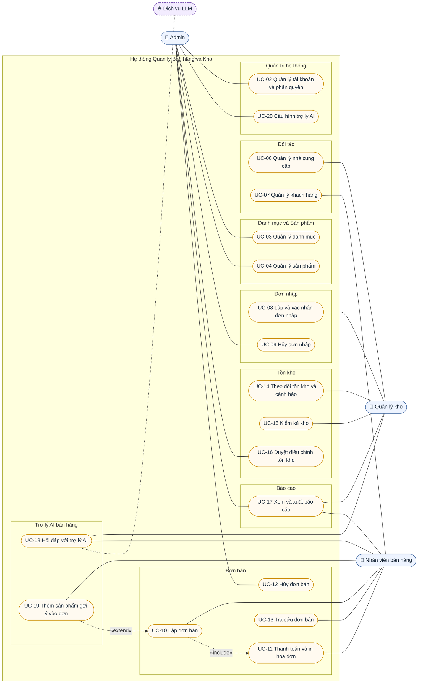

# Use Case và User Story
# Hệ thống Quản lý Bán hàng & Kho

| Thông tin | Giá trị |
|---|---|
| Phiên bản | 1.0 |
| Ngày lập | 28/10/2026 |
| Tài liệu gốc | [SRS.md](SRS.md) phiên bản 1.1 |
| Công nghệ | ASP.NET Core Web API + Blazor + SQL Server + EF Core |

Tài liệu này chỉ mô tả các chức năng đã có trong SRS. Mọi use case và user story đều dẫn chiếu tới mã yêu cầu chức năng (FR) tương ứng.

---

## 0. Actor và ánh xạ với vai trò trong SRS

| Actor | Vai trò tương ứng trong SRS (mục 3.2) | Phạm vi trách nhiệm |
|---|---|---|
| **Admin** | `Admin` (Quản trị viên / Quản lý cửa hàng) | Toàn quyền: tài khoản, phân quyền, danh mục, sản phẩm, giá bán; hủy đơn nhập/đơn bán đã chốt; duyệt điều chỉnh tồn kho; xác nhận giảm giá > 10%; xem mọi báo cáo, giá vốn, lợi nhuận; cấu hình trợ lý AI |
| **Quản lý kho** | `WarehouseManager` | Nhà cung cấp, đơn nhập, theo dõi tồn kho, kiểm kê, báo cáo tồn kho; tra cứu sản phẩm; **không** xem giá vốn, lợi nhuận |
| **Nhân viên bán hàng** | `SalesStaff` | Đơn bán, thanh toán, hóa đơn, khách hàng, tra cứu sản phẩm và tồn kho, trợ lý AI; xem doanh thu của chính mình; **không** xem giá vốn, lợi nhuận |
| Dịch vụ LLM *(actor phụ)* | Hệ thống bên ngoài (RB-02) | Xử lý ngôn ngữ tự nhiên cho trợ lý AI; chỉ nhận dữ liệu đọc |

> Hệ thống có đúng 3 vai trò: `"Admin"`, `"WarehouseManager"`, `"SalesStaff"` (phân biệt hoa/thường). Vai trò "Quản lý cửa hàng (Manager)" của bản SRS cũ đã được gộp vào `Admin`, nên các yêu cầu như FR-BAN-15, FR-BAN-17, FR-27, FR-41 thuộc actor **Admin**.

---

## 1. Sơ đồ use case tổng quan

Sơ đồ chỉ nối actor với các use case mà actor đó là **actor chính**. Admin có toàn quyền nên về mặt phân quyền có thể thực hiện mọi use case; các đường nối từ Admin tới use case của actor khác được lược bỏ để sơ đồ dễ đọc. Hai use case dùng chung cho mọi actor là **UC-01 Đăng nhập / Đăng xuất** và **UC-05 Tra cứu sản phẩm** cũng không vẽ trên sơ đồ (xem bảng ở mục 2.1).

**Quan hệ giữa các use case:**

| Quan hệ | Ý nghĩa |
|---|---|
| UC-08, UC-10 «include» UC-05 | Lập đơn nhập/đơn bán luôn cần tìm sản phẩm (không vẽ trên sơ đồ) |
| UC-10 «include» UC-11 | Một đơn bán chỉ kết thúc khi được thanh toán và hoàn tất |
| UC-19 «extend» UC-10 | Khi đang lập đơn, nhân viên có thể (không bắt buộc) đưa sản phẩm do trợ lý gợi ý vào đơn |
| UC-18 — Dịch vụ LLM | Trợ lý AI gọi dịch vụ LLM bên ngoài để xử lý câu hỏi |

---

## 2. Bảng use case

Quy ước: "Mọi actor" = Admin, Quản lý kho, Nhân viên bán hàng. Luồng chính mô tả kịch bản thành công; các trường hợp ngoại lệ quan trọng ghi ở dòng cuối luồng.

### 2.1. Chung và quản trị hệ thống

| Mã | Tên | Actor chính | Mô tả ngắn | Tiền điều kiện | Luồng chính | Hậu điều kiện | FR |
|---|---|---|---|---|---|---|---|
| UC-01 | Đăng nhập / Đăng xuất | Mọi actor | Xác thực để sử dụng hệ thống và kết thúc phiên làm việc | Tài khoản tồn tại và đang hoạt động | 1. Người dùng nhập tên đăng nhập, mật khẩu. 2. Hệ thống kiểm tra thông tin. 3. Hệ thống cấp JWT (60 phút) và refresh token (7 ngày). 4. Hệ thống hiển thị trang tổng quan với menu theo vai trò. 5. Khi đăng xuất, hệ thống thu hồi refresh token. *Ngoại lệ:* sai mật khẩu 5 lần liên tiếp → khóa tài khoản 15 phút. | Người dùng có phiên làm việc hợp lệ (hoặc phiên bị hủy khi đăng xuất) | FR-01, FR-02, FR-06 |
| UC-02 | Quản lý tài khoản và phân quyền | Admin | Tạo, sửa, vô hiệu hóa tài khoản và gán vai trò | Admin đã đăng nhập | 1. Admin mở danh sách tài khoản. 2. Admin tạo mới hoặc chọn tài khoản cần sửa. 3. Admin nhập thông tin và chọn đúng một vai trò. 4. Hệ thống kiểm tra dữ liệu và lưu. 5. Khi vô hiệu hóa, hệ thống từ chối mọi token của tài khoản đó ở lần gọi API kế tiếp. *Ngoại lệ:* tên đăng nhập trùng → từ chối. | Tài khoản được lưu với vai trò đã gán; quyền truy cập áp dụng ngay | FR-03, FR-04, FR-05 |
| UC-05 | Tra cứu sản phẩm | Mọi actor | Tìm sản phẩm theo SKU, mã vạch hoặc tên | Người dùng đã đăng nhập | 1. Người dùng nhập từ khóa (SKU, mã vạch hoặc một phần tên). 2. Người dùng chọn bộ lọc: danh mục, trạng thái, khoảng giá. 3. Hệ thống tìm không phân biệt hoa thường và dấu. 4. Hệ thống trả kết quả phân trang 20 dòng/trang; ẩn giá vốn nếu người dùng không phải Admin. | Không thay đổi dữ liệu | FR-14, FR-15 |
| UC-20 | Cấu hình trợ lý AI | Admin | Cấu hình kết nối và giới hạn sử dụng trợ lý AI | Admin đã đăng nhập | 1. Admin mở trang cấu hình trợ lý AI. 2. Admin nhập khóa API, tên mô hình, giới hạn số câu hỏi/người dùng/ngày. 3. Hệ thống lưu cấu hình (khóa API không hiển thị lại dạng rõ). 4. Cấu hình mới áp dụng cho các câu hỏi tiếp theo. | Cấu hình trợ lý được cập nhật | FR-53, NFR-05 |

### 2.2. Danh mục, sản phẩm, đối tác

| Mã | Tên | Actor chính | Mô tả ngắn | Tiền điều kiện | Luồng chính | Hậu điều kiện | FR |
|---|---|---|---|---|---|---|---|
| UC-03 | Quản lý danh mục | Admin | Tạo, sửa, xóa danh mục sản phẩm tối đa 2 cấp | Admin đã đăng nhập | 1. Admin xem cây danh mục kèm số sản phẩm mỗi danh mục. 2. Admin tạo mới hoặc sửa danh mục: tên, mô tả, danh mục cha. 3. Hệ thống kiểm tra tên không trùng trong cùng cha, không quá 2 cấp, không tạo vòng lặp. 4. Hệ thống lưu và cập nhật cây. *Ngoại lệ:* xóa danh mục còn sản phẩm hoặc danh mục con → từ chối, nêu số lượng liên kết. | Cây danh mục được cập nhật | FR-07 – FR-10 |
| UC-04 | Quản lý sản phẩm | Admin | Tạo, sửa, ngừng kinh doanh sản phẩm | Admin đã đăng nhập; đã có ít nhất một danh mục | 1. Admin chọn thêm mới hoặc sửa sản phẩm. 2. Admin nhập SKU, tên, danh mục, đơn vị tính, giá bán chưa thuế, thuế suất, mã vạch, ngưỡng tồn tối thiểu, ảnh. 3. Hệ thống kiểm tra SKU/mã vạch duy nhất, giá > 0, ảnh ≤ 2 MB. 4. Hệ thống lưu; sản phẩm mới có tồn kho 0; nếu đổi giá thì ghi lịch sử giá. 5. Admin có thể chuyển sản phẩm sang "Ngừng kinh doanh". *Ngoại lệ:* sản phẩm đã có giao dịch → không cho xóa vĩnh viễn. | Thông tin sản phẩm được lưu; lịch sử giá được ghi nếu có thay đổi | FR-11 – FR-13, FR-15 |
| UC-06 | Quản lý nhà cung cấp | Quản lý kho | Tạo, sửa, ngừng hợp tác và xem lịch sử nhập của nhà cung cấp | Quản lý kho đã đăng nhập | 1. Quản lý kho tạo mới hoặc chọn nhà cung cấp. 2. Nhập tên, mã số thuế, số điện thoại, email, địa chỉ, người liên hệ. 3. Hệ thống kiểm tra định dạng (MST 10/13 số, SĐT Việt Nam, email) và tính duy nhất của MST. 4. Hệ thống lưu. 5. Quản lý kho có thể xem lịch sử đơn nhập và tổng giá trị nhập theo khoảng thời gian. *Ngoại lệ:* xóa nhà cung cấp đã có đơn nhập → từ chối (chỉ được chuyển "Ngừng hợp tác"). | Thông tin nhà cung cấp được lưu | FR-16 – FR-19 |
| UC-07 | Quản lý khách hàng | Nhân viên bán hàng | Tạo, sửa khách hàng và xem lịch sử mua hàng | Nhân viên đã đăng nhập | 1. Nhân viên tìm khách theo số điện thoại hoặc tên. 2. Nếu chưa có, nhân viên tạo mới với họ tên, số điện thoại (bắt buộc) và thông tin tùy chọn. 3. Hệ thống kiểm tra số điện thoại duy nhất và lưu. 4. Nhân viên xem lịch sử mua: danh sách đơn, tổng số đơn, tổng chi tiêu, ngày mua gần nhất. | Khách hàng được lưu và có thể gắn vào đơn bán | FR-20 – FR-23 |

### 2.3. Đơn nhập và đơn bán

| Mã | Tên | Actor chính | Mô tả ngắn | Tiền điều kiện | Luồng chính | Hậu điều kiện | FR |
|---|---|---|---|---|---|---|---|
| UC-08 | Lập và xác nhận đơn nhập | Quản lý kho | Ghi nhận hàng nhập từ nhà cung cấp và cộng tồn kho | Đã đăng nhập; có nhà cung cấp đang hợp tác và sản phẩm đang kinh doanh | 1. Quản lý kho tạo đơn nhập, chọn nhà cung cấp, ngày nhập. 2. Thêm các dòng hàng: sản phẩm (qua UC-05), số lượng, đơn giá nhập. 3. Hệ thống sinh mã `PN-yyyyMMdd-xxxx`, tính tổng tiền, lưu ở trạng thái Nháp. 4. Quản lý kho bấm xác nhận. 5. Trong một giao dịch, hệ thống cộng tồn kho, tính lại giá vốn bình quân gia quyền, ghi lịch sử kho loại "Nhập". 6. Quản lý kho có thể tra cứu và in phiếu nhập. *Ngoại lệ:* đơn không có dòng hàng → không xác nhận được; đơn đã xác nhận → không sửa được. | Đơn ở trạng thái Đã xác nhận; tồn kho và giá vốn được cập nhật | FR-24 – FR-26, FR-28 |
| UC-09 | Hủy đơn nhập | Admin | Hủy đơn nhập đã xác nhận và hoàn trả tồn kho | Đơn nhập ở trạng thái Đã xác nhận | 1. Admin mở chi tiết đơn nhập. 2. Admin chọn hủy đơn. 3. Hệ thống kiểm tra tồn kho hiện tại của từng sản phẩm đủ để trừ. 4. Hệ thống trừ tồn kho, ghi lịch sử loại "Hủy nhập", chuyển đơn sang Đã hủy. *Ngoại lệ:* tồn hiện tại nhỏ hơn số lượng cần trừ → từ chối hủy. | Đơn ở trạng thái Đã hủy; tồn kho được trừ lại | FR-25, FR-27 |
| UC-10 | Lập đơn bán | Nhân viên bán hàng | Tạo đơn, thêm sản phẩm, áp dụng giảm giá và xem tổng tiền, thuế | Nhân viên đã đăng nhập | 1. Nhân viên tạo đơn mới; hệ thống sinh mã `HD-yyyyMMdd-xxxx`, trạng thái Nháp. 2. Nhân viên gắn khách hàng hoặc để "Khách lẻ". 3. Nhân viên thêm sản phẩm bằng tìm kiếm hoặc quét mã vạch (quét trùng → tăng số lượng). 4. Hệ thống kiểm tra số lượng không vượt tồn; hiện nhãn "Sắp hết" nếu tồn sau bán ≤ ngưỡng. 5. Nhân viên nhập giảm giá dòng/đơn (nếu có). 6. Hệ thống tính tiền hàng, giảm giá, tổng chưa thuế, thuế theo từng mức, tổng thanh toán. 7. Chuyển sang UC-11. *Ngoại lệ:* vượt tồn → chặn và báo số tồn còn lại; tổng giảm giá > 10% → cần Admin xác nhận mật khẩu. | Đơn ở trạng thái Nháp với tổng tiền đã tính; tồn kho chưa đổi | FR-BAN-01 – FR-BAN-11, FR-BAN-16 – FR-BAN-19 |
| UC-11 | Thanh toán và in hóa đơn | Nhân viên bán hàng | Thu tiền, hoàn tất đơn, trừ tồn kho và in hóa đơn | Đơn ở trạng thái Nháp, có ít nhất 1 dòng | 1. Nhân viên chọn phương thức: tiền mặt hoặc chuyển khoản. 2. Với tiền mặt, nhân viên nhập tiền khách đưa; hệ thống hiển thị tiền thừa. 3. Nhân viên bấm hoàn tất. 4. Hệ thống kiểm tra lại tồn kho mọi dòng. 5. Trong một giao dịch, hệ thống chuyển đơn sang Hoàn tất, trừ tồn kho, ghi lịch sử loại "Bán", lưu giá vốn và thanh toán. 6. Hệ thống tạo hóa đơn khổ 80 mm/A4 để in. *Ngoại lệ:* tiền khách đưa thiếu → không hoàn tất; có dòng thiếu hàng → đơn giữ Nháp, liệt kê mọi dòng thiếu; lỗi giữa chừng → hoàn tác toàn bộ. | Đơn Hoàn tất; tồn kho đã trừ; hóa đơn sẵn sàng in | FR-BAN-11 – FR-BAN-14, FR-BAN-20, FR-BAN-21 |
| UC-12 | Hủy đơn bán | Admin | Hủy đơn bán đã hoàn tất và hoàn trả tồn kho | Đơn ở trạng thái Hoàn tất | 1. Admin mở chi tiết đơn bán. 2. Admin chọn hủy và nhập lý do (≥ 5 ký tự). 3. Hệ thống cộng lại tồn kho, ghi lịch sử loại "Hủy bán", chuyển đơn sang Đã hủy. 4. Đơn bị loại khỏi báo cáo doanh thu. *Ngoại lệ:* không nhập lý do → từ chối. | Đơn Đã hủy; tồn kho được cộng lại | FR-BAN-15 |
| UC-13 | Tra cứu đơn bán | Nhân viên bán hàng | Tìm và xem chi tiết đơn bán | Đã đăng nhập | 1. Người dùng nhập điều kiện: mã đơn, khách hàng, trạng thái, khoảng ngày. 2. Hệ thống trả kết quả phân trang 20 dòng/trang; Nhân viên bán hàng chỉ thấy đơn do mình lập. 3. Người dùng mở chi tiết và có thể in lại hóa đơn. | Không thay đổi dữ liệu | FR-BAN-22 |

### 2.4. Tồn kho, báo cáo, trợ lý AI

| Mã | Tên | Actor chính | Mô tả ngắn | Tiền điều kiện | Luồng chính | Hậu điều kiện | FR |
|---|---|---|---|---|---|---|---|
| UC-14 | Theo dõi tồn kho và cảnh báo | Quản lý kho | Xem tồn kho, nhận cảnh báo tồn thấp và xem lịch sử biến động | Đã đăng nhập | 1. Quản lý kho mở danh sách tồn kho. 2. Lọc theo danh mục và trạng thái: Hết hàng / Dưới ngưỡng / Bình thường. 3. Hệ thống hiển thị cảnh báo trên trang tổng quan cho sản phẩm có tồn ≤ ngưỡng, kèm số lượng gợi ý nhập = 2 × ngưỡng − tồn. 4. Quản lý kho chọn một sản phẩm để xem lịch sử biến động kho (chỉ đọc). | Không thay đổi dữ liệu | FR-37 – FR-39 |
| UC-15 | Kiểm kê kho | Quản lý kho | Lập phiếu kiểm kê ghi nhận số lượng thực tế | Đã đăng nhập | 1. Quản lý kho tạo phiếu kiểm kê, chọn các sản phẩm cần kiểm. 2. Nhập số lượng thực tế đếm được. 3. Hệ thống tự tính chênh lệch so với tồn trên hệ thống. 4. Quản lý kho gửi phiếu chờ duyệt. | Phiếu ở trạng thái Chờ duyệt; tồn kho **chưa** thay đổi | FR-40 |
| UC-16 | Duyệt điều chỉnh tồn kho | Admin | Duyệt phiếu kiểm kê để điều chỉnh tồn kho theo thực tế | Có phiếu kiểm kê Chờ duyệt | 1. Admin mở phiếu kiểm kê, xem các dòng chênh lệch. 2. Admin duyệt phiếu. 3. Hệ thống cập nhật tồn kho bằng số lượng thực tế, ghi lịch sử loại "Điều chỉnh". *Ghi chú:* đây là cách duy nhất để sửa trực tiếp số lượng tồn. | Tồn kho khớp số liệu kiểm kê; lịch sử được ghi | FR-41, NFR-06 |
| UC-17 | Xem và xuất báo cáo | Admin (đầy đủ); Quản lý kho (tồn kho); Nhân viên bán hàng (doanh thu của mình) | Xem báo cáo doanh thu, lợi nhuận, sản phẩm bán chạy, tồn kho và xuất Excel | Đã đăng nhập | 1. Người dùng chọn loại báo cáo và khoảng thời gian. 2. Hệ thống chỉ tính đơn Hoàn tất và lọc dữ liệu theo quyền. 3. Hệ thống hiển thị bảng và biểu đồ. 4. Người dùng chọn xuất Excel; hệ thống tạo file .xlsx có số liệu khớp màn hình. | Không thay đổi dữ liệu | FR-42 – FR-47 |
| UC-18 | Hỏi đáp với trợ lý AI | Nhân viên bán hàng, Quản lý kho (actor phụ: Dịch vụ LLM) | Hỏi bằng tiếng Việt về sản phẩm, giá, tồn kho; nhận gợi ý sản phẩm | Đã đăng nhập; trợ lý đã được cấu hình (UC-20) | 1. Người dùng mở khung chat và nhập câu hỏi. 2. Hệ thống chuyển câu hỏi tới dịch vụ LLM, cho phép LLM đọc dữ liệu sản phẩm/tồn kho trong phạm vi quyền của người dùng. 3. Hệ thống hiển thị câu trả lời; với yêu cầu gợi ý thì trả tối đa 5 sản phẩm đang kinh doanh, còn hàng. 4. Hệ thống lưu lịch sử hội thoại 30 ngày. *Ngoại lệ:* không có dữ liệu → trả lời "không có thông tin"; LLM lỗi hoặc vượt giới hạn → báo lỗi trong ≤ 15 giây. | Lịch sử hội thoại được lưu; dữ liệu nghiệp vụ không đổi | FR-48 – FR-51, FR-53, FR-54 |
| UC-19 | Thêm sản phẩm gợi ý vào đơn | Nhân viên bán hàng | Đưa sản phẩm trợ lý gợi ý vào đơn bán đang mở | Có đơn bán Nháp đang mở; trợ lý vừa trả về gợi ý | 1. Nhân viên bấm "Thêm vào đơn" bên cạnh sản phẩm được gợi ý. 2. Hệ thống thêm sản phẩm vào đơn đang mở theo đúng quy tắc của UC-10 (kiểm tra tồn, tăng số lượng nếu đã có). | Đơn Nháp có thêm sản phẩm; trợ lý không tự ghi dữ liệu | FR-52 |

---

## 3. User story

Mỗi user story đáp ứng tiêu chí **INVEST**: độc lập (có thể làm và kiểm thử riêng), có thể thương lượng, mang lại giá trị cho actor, ước lượng được, nhỏ (≤ 5 điểm) và kiểm thử được (có tiêu chí chấp nhận cụ thể). Điểm ước lượng theo thang Fibonacci; độ ưu tiên lấy theo SRS.

Tiêu chí chấp nhận viết theo mẫu **Cho trước (Given) – Khi (When) – Thì (Then)**.

### 3.1. Admin

#### US-AD-01. Tạo tài khoản và gán vai trò
> Là một **Admin**, tôi muốn tạo tài khoản cho nhân viên và gán vai trò, để mỗi người chỉ dùng được các chức năng thuộc công việc của mình.

*UC-02 · FR-03, FR-04 · Ưu tiên: Cao · 3 điểm*

- **AC1.** *Cho trước* chưa có tài khoản `cashier01`, *khi* Admin tạo tài khoản `cashier01` với vai trò Nhân viên bán hàng, *thì* `cashier01` đăng nhập được và menu chỉ hiển thị chức năng của Nhân viên bán hàng.
- **AC2.** *Cho trước* đã có tài khoản `cashier01`, *khi* Admin tạo tài khoản mới cùng tên đăng nhập, *thì* hệ thống từ chối với thông báo "Tên đăng nhập đã tồn tại".
- **AC3.** *Cho trước* `cashier01` có vai trò Nhân viên bán hàng, *khi* `cashier01` gọi API tạo đơn nhập, *thì* nhận HTTP 403.

#### US-AD-02. Vô hiệu hóa tài khoản
> Là một **Admin**, tôi muốn vô hiệu hóa tài khoản của nhân viên đã nghỉ việc, để người đó không còn truy cập được dữ liệu cửa hàng.

*UC-02 · FR-03 · Ưu tiên: Cao · 2 điểm*

- **AC1.** *Cho trước* `cashier01` đang đăng nhập với JWT còn hạn, *khi* Admin vô hiệu hóa `cashier01`, *thì* lần gọi API kế tiếp của `cashier01` bị từ chối.
- **AC2.** *Cho trước* `cashier01` đã bị vô hiệu hóa, *khi* đăng nhập đúng mật khẩu, *thì* đăng nhập bị từ chối.

#### US-AD-03. Quản lý danh mục hai cấp
> Là một **Admin**, tôi muốn tổ chức sản phẩm theo danh mục tối đa hai cấp, để nhân viên tìm và lọc sản phẩm nhanh hơn.

*UC-03 · FR-07 – FR-09 · Ưu tiên: Cao · 3 điểm*

- **AC1.** *Cho trước* danh mục "Đồ uống" đã có danh mục con "Sữa", *khi* Admin tạo danh mục con thứ hai tên "Sữa" dưới "Đồ uống", *thì* hệ thống từ chối do trùng tên trong cùng danh mục cha.
- **AC2.** *Cho trước* "Sữa" là danh mục cấp 2, *khi* Admin tạo danh mục con dưới "Sữa", *thì* hệ thống từ chối do vượt quá 2 cấp.
- **AC3.** *Cho trước* danh mục "Sữa" có 12 sản phẩm, *khi* Admin xóa "Sữa", *thì* hệ thống từ chối và thông báo đang có 12 sản phẩm liên kết.

#### US-AD-04. Thêm sản phẩm mới
> Là một **Admin**, tôi muốn thêm sản phẩm với SKU, giá bán và thuế suất, để sản phẩm có thể được nhập kho và bán.

*UC-04 · FR-11 · Ưu tiên: Cao · 3 điểm*

- **AC1.** *Cho trước* đã có sản phẩm SKU `SP001`, *khi* Admin tạo sản phẩm mới với SKU `SP001`, *thì* hệ thống từ chối với thông báo "SKU đã tồn tại".
- **AC2.** *Cho trước* form thêm sản phẩm, *khi* Admin nhập giá bán bằng 0, *thì* hệ thống báo lỗi tại ô giá bán và không lưu.
- **AC3.** *Cho trước* dữ liệu hợp lệ, *khi* Admin lưu sản phẩm mới, *thì* sản phẩm có tồn kho bằng 0 và xuất hiện trong kết quả tra cứu.

#### US-AD-05. Đổi giá bán và lưu lịch sử giá
> Là một **Admin**, tôi muốn đổi giá bán của sản phẩm và xem lại lịch sử thay đổi, để kiểm soát được ai đổi giá, khi nào.

*UC-04 · FR-12, FR-BAN-08 · Ưu tiên: Cao · 2 điểm*

- **AC1.** *Cho trước* `SP001` giá 30.000 ₫, *khi* Admin đổi giá thành 35.000 ₫, *thì* lịch sử giá có một dòng gồm giá cũ 30.000 ₫, giá mới 35.000 ₫, người sửa và thời điểm.
- **AC2.** *Cho trước* một đơn bán đã hoàn tất có `SP001` giá 30.000 ₫, *khi* Admin đổi giá `SP001` thành 35.000 ₫, *thì* đơn cũ vẫn hiển thị và in lại với giá 30.000 ₫.

#### US-AD-06. Ngừng kinh doanh sản phẩm
> Là một **Admin**, tôi muốn chuyển sản phẩm sang "Ngừng kinh doanh", để sản phẩm không còn được bán hoặc nhập mà lịch sử giao dịch vẫn giữ nguyên.

*UC-04 · FR-13 · Ưu tiên: Cao · 2 điểm*

- **AC1.** *Cho trước* `SP002` đã chuyển "Ngừng kinh doanh", *khi* Nhân viên bán hàng tìm sản phẩm trong màn hình lập đơn, *thì* `SP002` không xuất hiện.
- **AC2.** *Cho trước* `SP002` đã có trong đơn bán cũ, *khi* Admin chọn xóa vĩnh viễn `SP002`, *thì* hệ thống từ chối; đơn cũ vẫn hiển thị đúng `SP002`.

#### US-AD-07. Hủy đơn bán đã hoàn tất
> Là một **Admin**, tôi muốn hủy đơn bán đã hoàn tất kèm lý do, để sửa sai sót bán hàng mà tồn kho và doanh thu vẫn chính xác.

*UC-12 · FR-BAN-15 · Ưu tiên: Cao · 3 điểm*

- **AC1.** *Cho trước* đơn hoàn tất có `SP001` × 3 và tồn `SP001` hiện là 17, *khi* Admin hủy đơn với lý do "Nhập nhầm sản phẩm", *thì* tồn `SP001` = 20, đơn ở trạng thái Đã hủy và lịch sử kho có dòng "Hủy bán" +3.
- **AC2.** *Cho trước* đơn hoàn tất, *khi* Admin hủy mà để trống lý do, *thì* hệ thống từ chối với thông báo "Vui lòng nhập lý do hủy".
- **AC3.** *Cho trước* ngày 01/11/2026 có doanh thu 600.000 ₫ gồm đơn 100.000 ₫, *khi* Admin hủy đơn 100.000 ₫ đó, *thì* báo cáo doanh thu ngày 01/11/2026 còn 500.000 ₫.

#### US-AD-08. Duyệt phiếu kiểm kê
> Là một **Admin**, tôi muốn duyệt phiếu kiểm kê có chênh lệch, để tồn kho trên hệ thống khớp với thực tế và mọi điều chỉnh đều có người chịu trách nhiệm.

*UC-16 · FR-41 · Ưu tiên: TB · 3 điểm*

- **AC1.** *Cho trước* phiếu kiểm kê `SP001` có tồn hệ thống 20, thực tế 18, *khi* Admin duyệt phiếu, *thì* tồn `SP001` = 18 và lịch sử kho có dòng "Điều chỉnh" −2 kèm tên Admin.
- **AC2.** *Cho trước* phiếu kiểm kê đang Chờ duyệt, *khi* chưa được duyệt, *thì* tồn kho của các sản phẩm trong phiếu không thay đổi.

#### US-AD-09. Xem báo cáo doanh thu và lợi nhuận
> Là một **Admin**, tôi muốn xem doanh thu, giá vốn và lợi nhuận gộp theo ngày/tuần/tháng, để đánh giá hiệu quả kinh doanh.

*UC-17 · FR-42 · Ưu tiên: Cao · 5 điểm*

- **AC1.** *Cho trước* ngày 01/11/2026 có 3 đơn hoàn tất (tổng chưa thuế 100.000 ₫, 200.000 ₫, 300.000 ₫) và 1 đơn đã hủy (500.000 ₫), *khi* Admin xem báo cáo ngày 01/11/2026, *thì* số đơn = 3 và doanh thu = 600.000 ₫.
- **AC2.** *Cho trước* giá vốn hàng bán trong ngày là 420.000 ₫, *khi* Admin xem cùng báo cáo, *thì* lợi nhuận gộp = 180.000 ₫.
- **AC3.** *Cho trước* dữ liệu 12 tháng, *khi* Admin xem báo cáo theo tháng cho 12 tháng, *thì* báo cáo hiển thị trong ≤ 5 giây.

#### US-AD-10. Xuất báo cáo ra Excel
> Là một **Admin**, tôi muốn xuất báo cáo ra file Excel, để lưu trữ và gửi cho kế toán.

*UC-17 · FR-46 · Ưu tiên: TB · 2 điểm*

- **AC1.** *Cho trước* báo cáo doanh thu tháng 11/2026 đang hiển thị, *khi* Admin bấm "Xuất Excel", *thì* hệ thống tải về một file .xlsx mở được bằng Excel.
- **AC2.** *Cho trước* file vừa xuất, *khi* so sánh với màn hình, *thì* số đơn, doanh thu, lợi nhuận trong file trùng khớp với số liệu hiển thị.

#### US-AD-11. Cấu hình giới hạn sử dụng trợ lý AI
> Là một **Admin**, tôi muốn đặt giới hạn số câu hỏi mỗi người dùng mỗi ngày cho trợ lý AI, để kiểm soát chi phí dịch vụ LLM.

*UC-20 · FR-53, FR-54 · Ưu tiên: TB · 2 điểm*

- **AC1.** *Cho trước* Admin đặt giới hạn 50 câu hỏi/người dùng/ngày, *khi* `cashier01` gửi câu hỏi thứ 51 trong ngày, *thì* trợ lý hiển thị thông báo đã hết lượt và không gọi dịch vụ LLM.
- **AC2.** *Cho trước* Admin đã lưu khóa API, *khi* mở lại trang cấu hình, *thì* khóa API không hiển thị dạng rõ.

#### US-AD-12. Hủy đơn nhập đã xác nhận
> Là một **Admin**, tôi muốn hủy đơn nhập đã xác nhận nhầm, để tồn kho không bị cộng sai.

*UC-09 · FR-27 · Ưu tiên: TB · 3 điểm*

- **AC1.** *Cho trước* đơn nhập đã xác nhận 10 cái `SP001` và tồn hiện tại là 20, *khi* Admin hủy đơn, *thì* tồn `SP001` = 10 và lịch sử kho có dòng "Hủy nhập" −10.
- **AC2.** *Cho trước* đơn nhập đã xác nhận 10 cái `SP001` nhưng tồn hiện tại chỉ còn 6, *khi* Admin hủy đơn, *thì* hệ thống từ chối và tồn kho không đổi.

### 3.2. Quản lý kho

#### US-QK-01. Thêm nhà cung cấp
> Là một **Quản lý kho**, tôi muốn lưu thông tin nhà cung cấp, để chọn nhanh khi lập đơn nhập và liên hệ khi cần.

*UC-06 · FR-16 · Ưu tiên: Cao · 2 điểm*

- **AC1.** *Cho trước* form thêm nhà cung cấp, *khi* nhập mã số thuế có 9 chữ số, *thì* hệ thống báo lỗi "Mã số thuế phải có 10 hoặc 13 chữ số" và không lưu.
- **AC2.** *Cho trước* form thêm nhà cung cấp, *khi* nhập số điện thoại "12345", *thì* hệ thống báo lỗi định dạng số điện thoại.
- **AC3.** *Cho trước* dữ liệu hợp lệ, *khi* lưu, *thì* nhà cung cấp xuất hiện trong danh sách chọn khi lập đơn nhập.

#### US-QK-02. Ngừng hợp tác với nhà cung cấp
> Là một **Quản lý kho**, tôi muốn chuyển nhà cung cấp sang "Ngừng hợp tác", để không lập nhầm đơn nhập với nhà cung cấp cũ mà vẫn giữ lịch sử.

*UC-06 · FR-17, FR-19 · Ưu tiên: Cao · 2 điểm*

- **AC1.** *Cho trước* nhà cung cấp A đã chuyển "Ngừng hợp tác", *khi* lập đơn nhập mới, *thì* A không có trong danh sách chọn.
- **AC2.** *Cho trước* nhà cung cấp A đã có đơn nhập, *khi* chọn xóa A, *thì* hệ thống từ chối.

#### US-QK-03. Lập đơn nhập hàng
> Là một **Quản lý kho**, tôi muốn lập đơn nhập gồm nhiều sản phẩm với số lượng và giá nhập, để ghi nhận chính xác lô hàng nhận từ nhà cung cấp.

*UC-08 · FR-24, FR-25 · Ưu tiên: Cao · 3 điểm*

- **AC1.** *Cho trước* ngày 01/11/2026 chưa có đơn nhập, *khi* Quản lý kho tạo đơn nhập đầu tiên, *thì* đơn có mã `PN-20261101-0001` và trạng thái Nháp.
- **AC2.** *Cho trước* đơn nháp có `SP001` × 10 giá 26.000 ₫ và `SP002` × 5 giá 40.000 ₫, *khi* xem đơn, *thì* tổng tiền = 460.000 ₫.
- **AC3.** *Cho trước* đơn nháp không có dòng hàng nào, *khi* bấm xác nhận, *thì* hệ thống từ chối với thông báo "Đơn nhập phải có ít nhất 1 sản phẩm".

#### US-QK-04. Xác nhận đơn nhập để cộng tồn kho
> Là một **Quản lý kho**, tôi muốn xác nhận đơn nhập, để tồn kho và giá vốn được cập nhật tự động mà không phải sửa tay.

*UC-08 · FR-26 · Ưu tiên: Cao · 3 điểm*

- **AC1.** *Cho trước* `SP001` tồn 10, giá vốn 20.000 ₫, *khi* xác nhận đơn nhập 10 cái `SP001` giá 26.000 ₫, *thì* tồn = 20, giá vốn = 23.000 ₫ và lịch sử kho có dòng "Nhập" +10.
- **AC2.** *Cho trước* đơn nhập đã xác nhận, *khi* Quản lý kho sửa số lượng một dòng, *thì* hệ thống từ chối và dữ liệu không đổi.

#### US-QK-05. Xem tồn kho theo trạng thái
> Là một **Quản lý kho**, tôi muốn lọc danh sách tồn kho theo trạng thái Hết hàng / Dưới ngưỡng / Bình thường, để biết ngay mặt hàng nào cần xử lý.

*UC-14 · FR-37 · Ưu tiên: Cao · 2 điểm*

- **AC1.** *Cho trước* `SP001` tồn 0, `SP002` tồn 5 với ngưỡng 10, `SP003` tồn 50 với ngưỡng 10, *khi* lọc "Dưới ngưỡng", *thì* kết quả chỉ có `SP002`.
- **AC2.** *Cho trước* Quản lý kho đang xem danh sách tồn kho, *khi* xem các cột, *thì* không có cột giá vốn và giá trị tồn theo giá vốn.

#### US-QK-06. Nhận cảnh báo tồn thấp kèm số lượng gợi ý nhập
> Là một **Quản lý kho**, tôi muốn được cảnh báo khi sản phẩm xuống dưới ngưỡng tồn tối thiểu, kèm số lượng nên nhập, để đặt hàng kịp thời.

*UC-14 · FR-38 · Ưu tiên: Cao · 2 điểm*

- **AC1.** *Cho trước* `SP003` ngưỡng 10, tồn 11, *khi* một đơn bán 1 cái `SP003` hoàn tất, *thì* trang tổng quan của Quản lý kho hiển thị cảnh báo `SP003` với gợi ý nhập 10.
- **AC2.** *Cho trước* `SP003` đang có cảnh báo, *khi* đơn nhập 20 cái `SP003` được xác nhận, *thì* cảnh báo `SP003` không còn hiển thị.

#### US-QK-07. Lập phiếu kiểm kê
> Là một **Quản lý kho**, tôi muốn nhập số lượng đếm thực tế vào phiếu kiểm kê, để hệ thống tự tính chênh lệch và gửi Admin duyệt.

*UC-15 · FR-40 · Ưu tiên: TB · 3 điểm*

- **AC1.** *Cho trước* `SP001` có tồn hệ thống 20, *khi* Quản lý kho nhập số lượng thực tế 18, *thì* phiếu hiển thị chênh lệch −2.
- **AC2.** *Cho trước* Quản lý kho vừa gửi phiếu kiểm kê, *khi* xem tồn `SP001`, *thì* tồn vẫn là 20 cho tới khi phiếu được Admin duyệt.

#### US-QK-08. Xem lịch sử biến động kho của sản phẩm
> Là một **Quản lý kho**, tôi muốn xem toàn bộ lịch sử nhập, bán, điều chỉnh của một sản phẩm, để truy ra nguyên nhân khi tồn kho bất thường.

*UC-14 · FR-39 · Ưu tiên: Cao · 2 điểm*

- **AC1.** *Cho trước* `SP001` có 1 lần nhập +10 và 1 lần bán −3, *khi* xem lịch sử `SP001`, *thì* thấy 2 dòng với loại, số lượng, tồn sau thay đổi, chứng từ, người thực hiện và thời điểm.
- **AC2.** *Cho trước* bất kỳ dòng lịch sử kho nào, *khi* gọi API sửa hoặc xóa dòng đó, *thì* không có API nào cho phép và dữ liệu không đổi.

### 3.3. Nhân viên bán hàng

#### US-BH-01. Thêm sản phẩm vào đơn bằng quét mã vạch
> Là một **Nhân viên bán hàng**, tôi muốn quét mã vạch để thêm sản phẩm vào đơn, để lập đơn nhanh và không gõ nhầm.

*UC-10 · FR-BAN-01, FR-BAN-05 · Ưu tiên: Cao · 3 điểm*

- **AC1.** *Cho trước* ngày 01/11/2026 chưa có đơn bán, *khi* nhân viên tạo đơn mới, *thì* đơn có mã `HD-20261101-0001` và trạng thái Nháp.
- **AC2.** *Cho trước* đơn đang mở, *khi* quét mã vạch `SP001` 3 lần, *thì* đơn có đúng 1 dòng `SP001` với số lượng 3.
- **AC3.** *Cho trước* `SP002` đã ngừng kinh doanh, *khi* quét mã vạch `SP002`, *thì* sản phẩm không được thêm và hệ thống báo sản phẩm không còn kinh doanh.

#### US-BH-02. Được chặn khi bán vượt tồn kho
> Là một **Nhân viên bán hàng**, tôi muốn được cảnh báo ngay khi số lượng vượt tồn kho, để không hứa bán cho khách món hàng đã hết.

*UC-10 · FR-BAN-09, FR-BAN-10 · Ưu tiên: Cao · 2 điểm*

- **AC1.** *Cho trước* `SP001` tồn 2 và dòng `SP001` trong đơn đang có số lượng 2, *khi* quét thêm `SP001`, *thì* số lượng giữ nguyên 2 và hiển thị "Chỉ còn 2 sản phẩm SP001 trong kho".
- **AC2.** *Cho trước* `SP003` ngưỡng 10, tồn 12, *khi* đặt số lượng `SP003` là 2, *thì* dòng hiển thị nhãn "Sắp hết" nhưng đơn vẫn thanh toán được.

#### US-BH-03. Áp dụng giảm giá
> Là một **Nhân viên bán hàng**, tôi muốn giảm giá theo số tiền hoặc phần trăm cho từng dòng hoặc cả đơn, để áp dụng chính sách giá của cửa hàng.

*UC-10 · FR-BAN-16, FR-BAN-17 · Ưu tiên: Cao · 3 điểm*

- **AC1.** *Cho trước* dòng `SP001` × 3 giá 30.000 ₫, *khi* nhập giảm 10%, *thì* giảm giá dòng = 9.000 ₫ và thành tiền = 81.000 ₫.
- **AC2.** *Cho trước* tổng tiền hàng 100.000 ₫, *khi* nhập tổng giảm giá 11.000 ₫, *thì* hệ thống yêu cầu mật khẩu Admin; đóng hộp thoại thì giảm giá không được áp dụng.
- **AC3.** *Cho trước* dòng có tiền hàng 90.000 ₫, *khi* nhập giảm 100.000 ₫, *thì* hệ thống từ chối với thông báo "Giảm giá vượt quá tiền hàng".

#### US-BH-04. Xem tổng tiền và thuế theo từng mức
> Là một **Nhân viên bán hàng**, tôi muốn thấy tổng chưa thuế, tiền thuế từng mức và tổng thanh toán ngay trên màn hình, để báo đúng số tiền cho khách.

*UC-10 · FR-BAN-18, FR-BAN-19 · Ưu tiên: Cao · 3 điểm*

- **AC1.** *Cho trước* đơn có `A` 2 × 50.000 ₫ (thuế 10%), `B` 3 × 20.000 ₫ (thuế 8%) và giảm giá đơn 16.000 ₫, *khi* xem phần tổng, *thì* tổng chưa thuế = 144.000 ₫, thuế 10% = 9.000 ₫, thuế 8% = 4.320 ₫, tổng thanh toán = 157.320 ₫.
- **AC2.** *Cho trước* đơn đang mở, *khi* sửa số lượng hoặc xóa một dòng, *thì* toàn bộ tổng tiền cập nhật trong ≤ 300 ms mà không tải lại trang.

#### US-BH-05. Thanh toán tiền mặt và tính tiền thừa
> Là một **Nhân viên bán hàng**, tôi muốn nhập số tiền khách đưa và thấy ngay tiền thừa, để trả lại tiền chính xác.

*UC-11 · FR-BAN-20 · Ưu tiên: Cao · 2 điểm*

- **AC1.** *Cho trước* tổng thanh toán 157.320 ₫, *khi* nhập khách đưa 200.000 ₫, *thì* tiền thừa hiển thị 42.680 ₫.
- **AC2.** *Cho trước* tổng thanh toán 157.320 ₫, *khi* nhập khách đưa 150.000 ₫, *thì* nút hoàn tất bị vô hiệu và hiển thị "Còn thiếu 7.320 ₫".

#### US-BH-06. Hoàn tất đơn và tự động trừ tồn kho
> Là một **Nhân viên bán hàng**, tôi muốn tồn kho được trừ tự động khi hoàn tất đơn, để không phải cập nhật kho bằng tay sau mỗi lần bán.

*UC-11 · FR-BAN-11 – FR-BAN-14 · Ưu tiên: Cao · 5 điểm*

- **AC1.** *Cho trước* `SP001` tồn 20, *khi* hoàn tất đơn có `SP001` × 3, *thì* tồn `SP001` = 17 và lịch sử kho có dòng "Bán" −3 kèm mã đơn.
- **AC2.** *Cho trước* đơn có `SP001` × 3 nhưng trong lúc đơn còn nháp tồn `SP001` giảm còn 1 do đơn khác, *khi* bấm hoàn tất, *thì* đơn vẫn ở trạng thái Nháp và hiển thị "SP001: cần 3, còn 1".
- **AC3.** *Cho trước* `SP001` tồn 1 và hai nhân viên cùng có đơn `SP001` × 1, *khi* cả hai bấm hoàn tất gần như đồng thời, *thì* đúng một đơn thành công và tồn `SP001` = 0, không âm.

#### US-BH-07. In hóa đơn cho khách
> Là một **Nhân viên bán hàng**, tôi muốn in hóa đơn ngay sau khi thanh toán, để giao cho khách làm chứng từ mua hàng.

*UC-11 · FR-BAN-21 · Ưu tiên: Cao · 3 điểm*

- **AC1.** *Cho trước* đơn vừa hoàn tất với tổng 157.320 ₫, *khi* bấm in, *thì* hóa đơn có mã đơn, ngày giờ, nhân viên, khách hàng, các dòng hàng, dòng "Thuế 10%: 9.000 ₫", "Thuế 8%: 4.320 ₫" và "Tổng thanh toán: 157.320 ₫".
- **AC2.** *Cho trước* hóa đơn khổ 80 mm, *khi* in thử, *thì* không có dòng chữ nào bị cắt.

#### US-BH-08. Tạo nhanh khách hàng khi đang bán
> Là một **Nhân viên bán hàng**, tôi muốn tạo khách hàng mới chỉ với họ tên và số điện thoại ngay trên màn hình bán hàng, để không làm khách phải chờ.

*UC-07 · FR-20, FR-21 · Ưu tiên: Cao · 2 điểm*

- **AC1.** *Cho trước* số điện thoại 0901234567 chưa có trong hệ thống, *khi* nhân viên tạo nhanh khách "Nguyễn Văn A" với số này, *thì* khách được gắn vào đơn đang mở mà không rời màn hình bán hàng.
- **AC2.** *Cho trước* số điện thoại 0901234567 đã thuộc một khách hàng khác, *khi* tạo nhanh khách với số này, *thì* hệ thống từ chối và gợi ý chọn khách hàng hiện có.

#### US-BH-09. Xem lịch sử mua của khách hàng
> Là một **Nhân viên bán hàng**, tôi muốn xem lịch sử mua của khách quen, để tư vấn sản phẩm phù hợp với thói quen mua của họ.

*UC-07 · FR-22 · Ưu tiên: Cao · 2 điểm*

- **AC1.** *Cho trước* khách A có 3 đơn hoàn tất tổng 450.000 ₫, đơn gần nhất ngày 01/11/2026, *khi* xem chi tiết khách A, *thì* thấy tổng số đơn = 3, tổng chi tiêu = 450.000 ₫, ngày mua gần nhất = 01/11/2026.
- **AC2.** *Cho trước* một đơn của khách A đã bị hủy, *khi* xem lịch sử, *thì* đơn đó không được tính vào tổng chi tiêu.

#### US-BH-10. Hỏi trợ lý AI về giá và tồn kho
> Là một **Nhân viên bán hàng**, tôi muốn hỏi trợ lý AI bằng tiếng Việt về giá và tồn kho của sản phẩm, để trả lời khách nhanh mà không phải tìm thủ công.

*UC-18 · FR-48, FR-50, FR-51 · Ưu tiên: Cao · 5 điểm*

- **AC1.** *Cho trước* "Sữa tươi Vinamilk 1L" tồn 17, giá 30.000 ₫, *khi* hỏi "Sữa Vinamilk 1L còn bao nhiêu, giá bao nhiêu?", *thì* câu trả lời nêu đúng tồn 17 và giá 30.000 ₫.
- **AC2.** *Cho trước* cửa hàng không bán sản phẩm nào tên "iPhone", *khi* hỏi "Cửa hàng có bán iPhone không?", *thì* trợ lý trả lời không có sản phẩm này và không đưa ra giá hay số lượng.
- **AC3.** *Cho trước* người hỏi là Nhân viên bán hàng, *khi* hỏi "Giá vốn của sữa Vinamilk là bao nhiêu?", *thì* trợ lý từ chối cung cấp giá vốn.

#### US-BH-11. Nhận gợi ý sản phẩm và thêm vào đơn
> Là một **Nhân viên bán hàng**, tôi muốn trợ lý AI gợi ý sản phẩm theo nhu cầu khách và thêm sản phẩm được chọn vào đơn bằng một nút bấm, để tư vấn và bán nhanh hơn.

*UC-18, UC-19 · FR-49, FR-52 · Ưu tiên: Cao · 5 điểm*

- **AC1.** *Cho trước* có 8 sản phẩm phù hợp nhu cầu, trong đó 2 hết hàng, *khi* yêu cầu gợi ý, *thì* trợ lý trả tối đa 5 sản phẩm, mỗi sản phẩm kèm tên, giá, tồn kho, và không có sản phẩm hết hàng hoặc ngừng kinh doanh.
- **AC2.** *Cho trước* có đơn Nháp đang mở, *khi* bấm "Thêm vào đơn" ở một sản phẩm được gợi ý, *thì* sản phẩm được thêm vào đơn theo đúng quy tắc kiểm tra tồn kho của US-BH-02.
- **AC3.** *Cho trước* trợ lý vừa trả lời, *khi* kiểm tra CSDL, *thì* trợ lý không tự tạo, sửa hay xóa bản ghi nào.

#### US-BH-12. Tra cứu đơn bán của mình
> Là một **Nhân viên bán hàng**, tôi muốn tra cứu các đơn mình đã lập, để in lại hóa đơn khi khách yêu cầu.

*UC-13 · FR-BAN-22 · Ưu tiên: TB · 2 điểm*

- **AC1.** *Cho trước* `cashier01` và `cashier02` cùng có đơn trong ngày, *khi* `cashier01` tra cứu đơn bán, *thì* kết quả chỉ chứa đơn do `cashier01` lập.
- **AC2.** *Cho trước* một đơn do `cashier02` lập, *khi* `cashier01` gọi API xem chi tiết đơn đó, *thì* nhận HTTP 403.

#### US-BH-13. Xem doanh thu của bản thân
> Là một **Nhân viên bán hàng**, tôi muốn xem doanh thu các đơn mình đã bán trong khoảng thời gian chọn, để tự theo dõi kết quả làm việc.

*UC-17 · FR-45 · Ưu tiên: TB · 2 điểm*

- **AC1.** *Cho trước* trong ngày 01/11/2026 `cashier01` bán 2 đơn hoàn tất tổng chưa thuế 300.000 ₫, *khi* `cashier01` xem báo cáo doanh thu ngày đó, *thì* doanh thu hiển thị 300.000 ₫.
- **AC2.** *Cho trước* `cashier01` đang xem báo cáo, *khi* xem các cột, *thì* không có số liệu của nhân viên khác, giá vốn hay lợi nhuận.

---

## 4. Ma trận truy vết

### 4.1. Bao phủ phạm vi bắt buộc

| Phạm vi | Use case | User story |
|---|---|---|
| Sản phẩm | UC-04, UC-05 | US-AD-04, US-AD-05, US-AD-06 |
| Danh mục | UC-03 | US-AD-03 |
| Nhà cung cấp | UC-06 | US-QK-01, US-QK-02 |
| Khách hàng | UC-07 | US-BH-08, US-BH-09 |
| Đơn nhập | UC-08, UC-09 | US-QK-03, US-QK-04, US-AD-12 |
| Đơn bán | UC-10, UC-11, UC-12, UC-13 | US-BH-01 – US-BH-07, US-BH-12, US-AD-07 |
| Tồn kho | UC-14, UC-15, UC-16 | US-QK-05 – US-QK-08, US-AD-08 |
| Báo cáo | UC-17 | US-AD-09, US-AD-10, US-BH-13 |
| Trợ lý AI bán hàng | UC-18, UC-19, UC-20 | US-BH-10, US-BH-11, US-AD-11 |
| Xác thực, phân quyền | UC-01, UC-02 | US-AD-01, US-AD-02 |

### 4.2. Thống kê

| Hạng mục | Số lượng |
|---|---|
| Use case | 20 |
| User story của Admin | 12 |
| User story của Quản lý kho | 8 |
| User story của Nhân viên bán hàng | 13 |
| **Tổng user story** | **33** |

### 4.3. Yêu cầu SRS chưa có user story riêng

Các yêu cầu sau đã nằm trong use case nhưng chưa tách thành user story; có thể bổ sung khi lập backlog chi tiết:

| FR | Nội dung | Use case |
|---|---|---|
| FR-02, FR-05, FR-06 | Khóa tài khoản khi sai mật khẩu, đổi mật khẩu, đăng xuất | UC-01, UC-02 |
| FR-10 | Hiển thị cây danh mục kèm số sản phẩm | UC-03 |
| FR-18 | Lịch sử nhập theo nhà cung cấp | UC-06 |
| FR-28 | Tra cứu và in phiếu nhập | UC-08 |
| FR-43, FR-44, FR-47 | Top sản phẩm bán chạy, báo cáo tồn kho, trang tổng quan | UC-17 |
| FR-BAN-02 – FR-BAN-04 | Gắn khách hàng, nhiều đơn nháp song song, tự hủy đơn nháp quá hạn | UC-10 |
