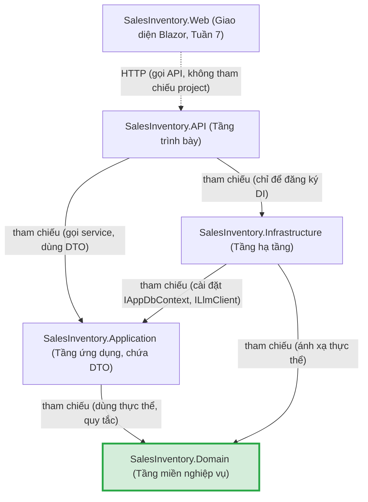

# Kiến trúc phần mềm
# Hệ thống Quản lý Bán hàng & Kho

| Thông tin | Giá trị |
|---|---|
| Phiên bản | 1.0 |
| Ngày lập | 28/10/2026 |
| Tài liệu gốc | [SRS.md](SRS.md) v1.1, [UseCases.md](UseCases.md) v1.0, [database-design.md](database-design.md) v1.0 |
| Nền tảng | .NET 8, ASP.NET Core Web API, Blazor, EF Core, SQL Server |
| Kiểu kiến trúc | Phân lớp theo hướng Clean Architecture, giản lược cho quy mô đồ án |

Tài liệu mô tả cấu trúc solution, trách nhiệm từng project và quy tắc phụ thuộc giữa chúng. Tên project/lớp dùng tiếng Anh theo quy ước .NET; mô tả bằng tiếng Việt.

---

## 1. Nguyên tắc chọn kiến trúc

- **Domain ở trung tâm, không phụ thuộc gì.** Thực thể và quy tắc nghiệp vụ cốt lõi (trừ kho, hủy đơn, tính tổng tiền) không biết đến CSDL, HTTP hay LLM, nên kiểm thử được bằng unit test thuần, không cần CSDL.
- **Chỉ trừu tượng hóa ở nơi có lợi thật.** Application nói chuyện với CSDL qua `IAppDbContext` và với LLM qua `ILlmClient`; không thêm Repository chung, MediatR hay CQRS (lý do ở mục 4).
- **Trình biên dịch ép quy tắc phụ thuộc.** Mỗi lớp là một project riêng, chỉ khai báo `<ProjectReference>` theo đúng chiều ở mục 3; viết sai chiều sẽ không build được.

---

## 2. Cấu trúc solution

```text
SalesInventory.sln
├── src/
│   ├── SalesInventory.Domain/          Lõi nghiệp vụ, không tham chiếu project nào
│   ├── SalesInventory.Application/     Ca sử dụng (use case), giao diện ra ngoài
│   ├── SalesInventory.Infrastructure/  EF Core, SQL Server, LLM, JWT
│   ├── SalesInventory.API/             Controller, cấu hình DI (composition root)
│   └── SalesInventory.Web/             Giao diện Blazor, gọi API qua HTTP (chỉ tạo ở Tuần 7)
└── tests/
    ├── SalesInventory.Domain.Tests/        Unit test thuần cho quy tắc nghiệp vụ
    ├── SalesInventory.Application.Tests/   Test service trên SQLite in-memory + LLM giả
    └── SalesInventory.Api.Tests/           Integration test qua HTTP (WebApplicationFactory)
```

Kiến trúc lõi có đúng **4 project**: Domain, Application, Infrastructure, API. `Web` không phải là "lớp" trong kiến trúc lõi: đó là ứng dụng khách đứng ngoài, chỉ giao tiếp với API qua HTTP, và chưa được tạo trước Tuần 7. DTO request/response nằm ở **Application**. Không có project `Contracts`; nếu tới Tuần 7 Blazor bị lặp model thì xem xét lại.

### 2.1. Trách nhiệm từng lớp

| Lớp | Trách nhiệm | Ví dụ thành phần trong dự án này |
|---|---|---|
| **Domain** (Miền nghiệp vụ) | Thực thể, enum, quy tắc nghiệp vụ bất biến gắn với dữ liệu của chính thực thể; ngoại lệ nghiệp vụ. Không tham chiếu project nào, không dùng gói NuGet nào (kể cả EF Core). | Thực thể `Product`, `Category`, `Supplier`, `Customer`, `PurchaseOrder`/`PurchaseOrderItem`, `SalesOrder`/`SalesOrderItem`, `StockMovement`, `StockCount`, `AiConversation`/`AiMessage`; enum `OrderStatus`; phương thức `Product.DecreaseStock(qty)` (ném `BusinessRuleException` khi không đủ tồn), `SalesOrder.Cancel()`, thuộc tính `SalesOrder.Total`; `BusinessRuleException` |
| **Application** (Ứng dụng / ca sử dụng) | Điều phối từng ca sử dụng: nạp dữ liệu, gọi quy tắc Domain, lưu thay đổi trong một giao dịch; kiểm tra dữ liệu vào; kiểm tra quyền ở mức nghiệp vụ; khai báo giao diện cho mọi thứ bên ngoài mà nó cần. | `SalesOrderService.CreateAsync` (gộp dòng trùng, trừ kho, ghi `StockMovement` và cập nhật `Product.StockQuantity` trong cùng transaction), `PurchaseOrderService`, `InventoryService`, `ReportService`, `AiAssistantService` (dựng ngữ cảnh từ dữ liệu sản phẩm, lọc dữ liệu theo vai trò – FR-50); giao diện `IAppDbContext`, `ILlmClient`, `ICurrentUser`; `NotFoundException`; DTO request/response (`CreateSalesOrderRequest`, `SalesOrderDto`, `ProductDto`, `AiChatRequest`/`AiChatResponse`); validator cho request |
| **Infrastructure** (Hạ tầng) | Cài đặt các giao diện do Application khai báo bằng công nghệ cụ thể: truy cập CSDL, gọi dịch vụ ngoài, bảo mật. | `AppDbContext : DbContext, IAppDbContext`; cấu hình Fluent API (`ProductConfiguration`, …); thư mục `Migrations`; `OpenAiLlmClient : ILlmClient` (HttpClient, timeout 15 giây – FR-54); `JwtTokenService`, `PasswordHasher`; `DependencyInjection.AddInfrastructure()` |
| **Api** (Trình bày) | Nhận HTTP, ánh xạ request → gọi service Application → trả DTO; xác thực/phân quyền; chuyển ngoại lệ thành `ProblemDetails`; là nơi duy nhất ghép các lớp lại (composition root). | `ProductsController`, `SalesOrdersController`, `ReportsController`, `AiChatController`; `BusinessExceptionHandler` (404/409); `Program.cs` gọi `AddApplication()` và `AddInfrastructure()`; `HttpCurrentUser : ICurrentUser` |
| *Web* (Giao diện Blazor) | Màn hình người dùng; gọi Api qua `HttpClient`; không biết đến Domain hay CSDL. | Trang Sản phẩm, Bán hàng, Tồn kho, Báo cáo; khung chat trợ lý AI |

---

## 3. Chiều phụ thuộc

### 3.1. Sơ đồ

Mũi tên `A --> B` nghĩa là **A tham chiếu (phụ thuộc vào) B**. Domain không có mũi tên nào đi ra.



### 3.2. Bảng tham chiếu project

| Project | Được phép tham chiếu | Không được tham chiếu |
|---|---|---|
| Domain | *(không có)* | Mọi project khác; mọi gói NuGet hạ tầng |
| Application | Domain | Infrastructure, API, Web |
| Infrastructure | Application (kéo theo Domain), Domain | API, Web |
| API | Application, Infrastructure | Web |
| Web (Tuần 7) | *(không có; gọi API qua HTTP)* | Domain, Application, Infrastructure, API |

### 3.3. Quy tắc phụ thuộc

1. **Phụ thuộc chỉ hướng vào trong**: Api/Infrastructure → Application → Domain. Lớp trong không biết lớp ngoài tồn tại.
2. **Đảo phụ thuộc ở ranh giới hạ tầng**: Application *khai báo* giao diện (`IAppDbContext`, `ILlmClient`, `ICurrentUser`), Infrastructure/Api *cài đặt*. Nhờ vậy mũi tên phụ thuộc trỏ từ Infrastructure vào Application, không phải ngược lại.
3. **Api chỉ chạm Infrastructure ở `Program.cs`** để đăng ký DI. Controller chỉ inject service của Application, không inject `AppDbContext`.
4. **Thực thể không đi ra khỏi server**: controller luôn trả DTO (khai báo ở Application); Web không bao giờ thấy thực thể Domain.
5. **Domain sạch thuộc tính hạ tầng**: không dùng `[JsonIgnore]`, `[Table]`, `[Column]`… trên thực thể; ràng buộc CSDL cấu hình bằng Fluent API trong Infrastructure, định dạng JSON do DTO quyết định.

---

## 4. EF Core DbContext và Repository nằm ở đâu, vì sao

### 4.1. `AppDbContext` nằm ở Infrastructure

- `AppDbContext` gắn chặt với công nghệ: kế thừa `DbContext`, dùng nhà cung cấp SQL Server, chứa cấu hình Fluent API, chuỗi kết nối và Migrations. Đó đúng là "chi tiết hạ tầng", nên thuộc lớp ngoài cùng.
- Application không tham chiếu Infrastructure, nên nó làm việc với CSDL qua giao diện **`IAppDbContext`** do chính Application khai báo:

```csharp
// SalesInventory.Application/Abstractions/IAppDbContext.cs
public interface IAppDbContext
{
    DbSet<Product> Products { get; }
    DbSet<SalesOrder> SalesOrders { get; }
    DbSet<StockMovement> StockMovements { get; }
    // ... các DbSet khác
    Task<int> SaveChangesAsync(CancellationToken ct = default);
}

// SalesInventory.Infrastructure/Persistence/AppDbContext.cs
public class AppDbContext(DbContextOptions<AppDbContext> options)
    : DbContext(options), IAppDbContext { ... }
```

- **Đánh đổi có chủ đích**: Application tham chiếu gói `Microsoft.EntityFrameworkCore` (để dùng `DbSet<T>`, `Include`, `ToListAsync`), nhưng **không** tham chiếu `Microsoft.EntityFrameworkCore.SqlServer`. Application biết "có một ORM", không biết "CSDL là SQL Server". Domain vẫn hoàn toàn không phụ thuộc EF Core.

### 4.2. Không dùng Repository chung (`IRepository<T>`)

- `DbSet<T>` **đã là** Repository và `DbContext` **đã là** Unit of Work. Bọc thêm `IRepository<T>` cho khoảng 20 bảng chỉ nhân đôi code mà không thêm khả năng mới.
- Repository chung thường che mất `Include`, phép chiếu (`Select` sang DTO) và `AsNoTracking`, khiến truy vấn báo cáo kém hiệu quả hoặc phải "lách" abstraction.
- Giao dịch nhiều bảng (tạo đơn bán + trừ tồn + ghi `StockMovement`) chỉ cần một lần `SaveChangesAsync()`; không cần thêm lớp Unit of Work riêng.
- **Khả năng kiểm thử vẫn được giữ**: test Application dùng `AppDbContext` thật trên SQLite in-memory (như `TestDb` hiện có), nên kiểm thử được cả truy vấn EF lẫn nghiệp vụ, đáng tin hơn mock repository.

### 4.3. Khi nào mới tạo "repository" riêng

Chỉ tạo giao diện truy vấn **chuyên biệt** (không phải chung) khi truy vấn không biểu diễn tốt bằng LINQ, ví dụ báo cáo dùng SQL thuần hoặc view:

| Giao diện (khai báo ở Application) | Cài đặt (ở Infrastructure) | Lý do |
|---|---|---|
| `IReportQueries` | `SqlReportQueries` (Dapper hoặc `FromSql`) | Báo cáo doanh thu/tồn kho tổng hợp nhiều bảng, cần SQL tối ưu |

Nguyên tắc: giao diện vẫn nằm ở Application, cài đặt ở Infrastructure, giữ đúng chiều phụ thuộc ở mục 3.

---

## 5. Ánh xạ từ mã hiện tại

Mã ban đầu nằm hết trong project API. Trạng thái tách theo kiến trúc trên:

| Vị trí ban đầu (trong API) | Chuyển đến | Trạng thái / ghi chú |
|---|---|---|
| `Models/*.cs` | Domain/Entities | **Đã chuyển.** Đã bỏ `[JsonIgnore]`, `[ConcurrencyCheck]`; ràng buộc cấu hình bằng Fluent API |
| `Data/AppDbContext.cs`, `Data/Migrations/` | Infrastructure/Persistence | **Đã chuyển.** Migration được tạo lại thành `InitialCreate` trong Infrastructure; đăng ký qua `AddInfrastructure()` |
| `Services/OrderService.cs`, `ProductService.cs` | Application/Services | **Chưa chuyển** (nợ kỹ thuật, Bài 16; xem `solution-structure.md`). Đưa kiểm tra tồn kho vào `Product.DecreaseStock` |
| `Services/Exceptions.cs` | `BusinessRuleException` → Domain; `NotFoundException` → Application; `BusinessExceptionHandler` → API | Chưa chuyển; handler phụ thuộc ASP.NET Core nên ở lại API |
| `Dtos/*.cs` | Application/Dtos | Chưa chuyển; đi cùng Services ở Bài 16 |
| `Controllers/*.cs`, `Program.cs` | API | Ở đúng chỗ. `Program.cs` gọi `AddInfrastructure()`, sau này thêm `AddApplication()` |
| `tests/SalesInventory.Api.Tests` | Tách thành Domain.Tests, Application.Tests, Api.Tests | `TestDb` chuyển sang Application.Tests |
