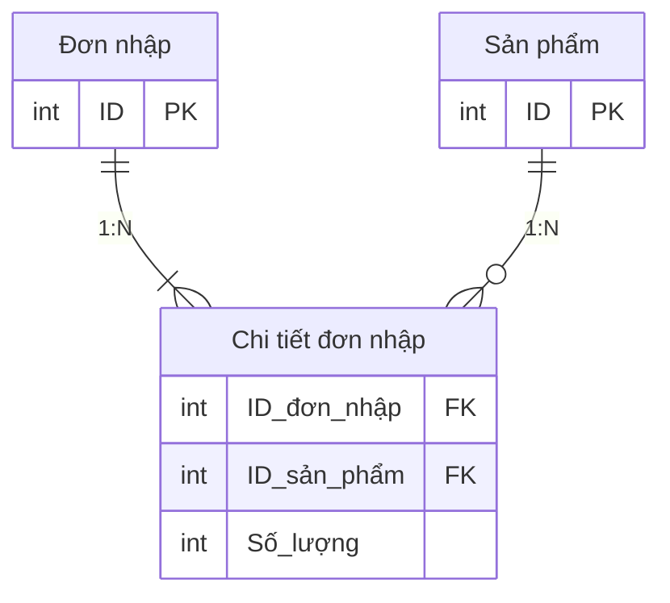

# Thiết kế cơ sở dữ liệu
# Hệ thống Quản lý Bán hàng & Kho

| Thông tin | Giá trị |
|---|---|
| Phiên bản | 1.0 |
| Ngày lập | 28/10/2026 |
| Tài liệu gốc | [SRS.md](SRS.md) v1.1, [UseCases.md](UseCases.md) v1.0 |
| Hệ quản trị CSDL | SQL Server 2019 trở lên |
| Cách tiếp cận | Entity Framework Core code-first (lược đồ sinh từ entity + migration) |

Tài liệu mô tả lược đồ logic và vật lý; chưa có mã C#. Tên bảng/cột dùng tiếng Anh (PascalCase, bảng số nhiều) để khớp quy ước EF Core; mô tả bằng tiếng Việt.

---

## Sơ đồ ERD tổng quan

Sơ đồ thể hiện đủ 20 bảng, khóa chính (PK), khóa ngoại (FK), khóa duy nhất (UK) và một số cột chính; danh sách cột đầy đủ xem mục 3. Tên bảng/cột được Việt hóa để trình bày; tên bảng thật ghi trong ngoặc, cột `ID_<x>` tương ứng cột `<X>Id` trong CSDL (ví dụ `ID_danh_mục` ↔ `CategoryId`).

**Cách đọc ký hiệu (crow's foot):**

| Ký hiệu ở một đầu đường nối | Ý nghĩa |
|---|---|
| `\|\|` | Đúng một |
| `\|o` | Không hoặc một (khóa ngoại cho phép NULL) |
| `\|{` | Một hoặc nhiều |
| `o{` | Không hoặc nhiều |

Ví dụ `Đơn nhập ||--|{ Chi tiết đơn nhập`: mỗi dòng chi tiết thuộc **đúng một** đơn nhập, mỗi đơn nhập có **một hoặc nhiều** dòng chi tiết. Nhãn trên đường nối ghi loại quan hệ (1:N) và ý nghĩa nghiệp vụ.

```mermaid
erDiagram
    VT["Vai trò (Roles)"] {
        tinyint ID PK
        varchar Tên_vai_trò UK
    }
    ND["Người dùng (Users)"] {
        int ID PK
        varchar Tên_đăng_nhập UK
        tinyint ID_vai_trò FK
    }
    TK["Token làm mới (RefreshTokens)"] {
        bigint ID PK
        int ID_người_dùng FK
        varchar Hash_token UK
    }
    DM["Danh mục (Categories)"] {
        int ID PK
        nvarchar Tên_danh_mục
        int ID_danh_mục_cha FK
    }
    SP["Sản phẩm (Products)"] {
        int ID PK
        varchar Mã_SKU UK
        varchar Mã_vạch UK
        int ID_danh_mục FK
        decimal Giá_bán
        tinyint Thuế_suất
        int Tồn_hiện_tại
    }
    LSG["Lịch sử giá (ProductPriceHistories)"] {
        int ID PK
        int ID_sản_phẩm FK
        int ID_người_sửa FK
    }
    NCC["Nhà cung cấp (Suppliers)"] {
        int ID PK
        nvarchar Tên_nhà_cung_cấp
        varchar Mã_số_thuế UK
    }
    KH["Khách hàng (Customers)"] {
        int ID PK
        nvarchar Họ_tên
        varchar Số_điện_thoại UK
    }
    DN["Đơn nhập (PurchaseOrders)"] {
        int ID PK
        varchar Mã_đơn UK
        int ID_nhà_cung_cấp FK
        int ID_người_lập FK
        int ID_người_xác_nhận FK
        int ID_người_hủy FK
        varchar Trạng_thái
    }
    CTDN["Chi tiết đơn nhập (PurchaseOrderItems)"] {
        int ID PK
        int ID_đơn_nhập FK
        int ID_sản_phẩm FK
        int Số_lượng
        decimal Đơn_giá_nhập
    }
    DB["Đơn bán (SalesOrders)"] {
        int ID PK
        varchar Mã_đơn UK
        int ID_khách_hàng FK
        int ID_người_lập FK
        int ID_người_duyệt_giảm_giá FK
        int ID_người_hủy FK
        varchar Trạng_thái
        decimal Tổng_thanh_toán
    }
    CTDB["Chi tiết đơn bán (SalesOrderItems)"] {
        int ID PK
        int ID_đơn_bán FK
        int ID_sản_phẩm FK
        int Số_lượng
        decimal Đơn_giá
    }
    SM["Biến động kho (StockMovements)"] {
        int ID PK
        int ID_sản_phẩm FK
        varchar Loại_biến_động
        int Số_lượng
        int Tồn_sau
        varchar Loại_chứng_từ
        int ID_chứng_từ
        nvarchar Lý_do
        datetime2 Thời_điểm_UTC
    }
    PKK["Phiếu kiểm kê (StockCounts)"] {
        int ID PK
        varchar Mã_phiếu UK
        int ID_người_lập FK
        int ID_người_duyệt FK
        varchar Trạng_thái
    }
    CTKK["Chi tiết kiểm kê (StockCountItems)"] {
        int ID PK
        int ID_phiếu_kiểm_kê FK
        int ID_sản_phẩm FK
        int Tồn_hệ_thống
        int Tồn_thực_tế
    }
    CHAI["Cấu hình AI (AiSettings)"] {
        tinyint ID PK
        varchar Tên_mô_hình
        int Giới_hạn_câu_hỏi_ngày
        int ID_người_cập_nhật FK
    }
    HT["Hội thoại AI (AiConversations)"] {
        bigint ID PK
        int ID_người_dùng FK
    }
    TN["Tin nhắn AI (AiMessages)"] {
        bigint ID PK
        bigint ID_hội_thoại FK
        varchar Người_gửi
    }
    NK["Nhật ký kiểm toán (AuditLogs)"] {
        bigint ID PK
        int ID_người_dùng FK
        varchar Hành_động
    }
    BD["Bộ đếm chứng từ (DocumentCounters)"] {
        varchar Tiền_tố PK
        date Ngày PK
        int Số_cuối
    }

    VT ||--o{ ND : "1:N gán cho"
    ND ||--o{ TK : "1:N sở hữu"
    DM |o--o{ DM : "1:N cha của"
    DM ||--o{ SP : "1:N chứa"
    SP ||--o{ LSG : "1:N có lịch sử giá"
    NCC ||--o{ DN : "1:N cung cấp"
    DN ||--|{ CTDN : "1:N gồm"
    SP ||--o{ CTDN : "1:N được nhập"
    KH |o--o{ DB : "1:N mua"
    DB ||--|{ CTDB : "1:N gồm"
    SP ||--o{ CTDB : "1:N được bán"
    PKK ||--|{ CTKK : "1:N gồm"
    SP ||--o{ CTKK : "1:N được kiểm"
    SP ||--o{ SM : "1:N biến động"
    DN |o..o{ SM : "tham chiếu logic (không FK)"
    DB |o..o{ SM : "tham chiếu logic (không FK)"
    PKK |o..o{ SM : "tham chiếu logic (không FK)"
    HT ||--|{ TN : "1:N gồm"

    ND ||--o{ LSG : "1:N đổi giá"
    ND ||--o{ DN : "1:N lập"
    ND |o--o{ DN : "1:N xác nhận"
    ND |o--o{ DN : "1:N hủy"
    ND ||--o{ DB : "1:N lập"
    ND |o--o{ DB : "1:N duyệt giảm giá"
    ND |o--o{ DB : "1:N hủy"
    ND ||--o{ PKK : "1:N lập"
    ND |o--o{ PKK : "1:N duyệt"
    ND |o--o{ CHAI : "1:N cập nhật"
    ND ||--o{ HT : "1:N trò chuyện"
    ND |o--o{ NK : "1:N thực hiện"
```



### Giải thích các quan hệ

**Loại quan hệ có trong thiết kế:** mọi quan hệ vật lý đều là **1:N**. Thiết kế **không có quan hệ 1:1**: hai thực thể luôn đi cùng nhau theo tỉ lệ 1:1 thì gộp vào một bảng, nên không tách. Thiết kế cũng **không có quan hệ N:M trực tiếp**: ba quan hệ N:M về nghiệp vụ đều được tách bằng bảng trung gian (xem cuối mục).

**1. Người dùng và phân quyền**
- **Vai trò – Người dùng (1:N):** một vai trò được gán cho nhiều người dùng; mỗi người dùng có đúng một vai trò (`ID_vai_trò` NOT NULL). Đây không phải N:M vì SRS quy định mỗi tài khoản chỉ có một vai trò (FR-03).
- **Người dùng – Token làm mới (1:N):** một người dùng đăng nhập trên nhiều máy thì có nhiều token. Khi xóa người dùng thì token bị xóa theo (CASCADE).

**2. Danh mục và sản phẩm**
- **Danh mục – Danh mục (1:N, tự tham chiếu):** một danh mục cha có nhiều danh mục con; danh mục cấp 1 có `ID_danh_mục_cha` = NULL, nên đầu "cha" là `|o`. Giới hạn 2 cấp được kiểm tra ở tầng ứng dụng.
- **Danh mục – Sản phẩm (1:N):** mỗi sản phẩm bắt buộc thuộc đúng một danh mục; một danh mục chứa nhiều sản phẩm. Không xóa được danh mục còn sản phẩm.
- **Sản phẩm – Lịch sử giá (1:N)** và **Người dùng – Lịch sử giá (1:N):** mỗi lần đổi giá sinh một dòng lịch sử, ghi rõ sản phẩm nào và ai sửa.

**3. Nhập hàng**
- **Nhà cung cấp – Đơn nhập (1:N):** một nhà cung cấp có nhiều đơn nhập; mỗi đơn nhập của đúng một nhà cung cấp. Nhà cung cấp đã có đơn thì không xóa được, chỉ chuyển "Ngừng hợp tác".
- **Đơn nhập – Chi tiết đơn nhập (1:N, ít nhất một dòng):** chi tiết bị xóa theo khi xóa đơn nháp (CASCADE).
- **Sản phẩm – Chi tiết đơn nhập (1:N):** một sản phẩm xuất hiện trong nhiều đơn nhập khác nhau.

**4. Bán hàng**
- **Khách hàng – Đơn bán (1:N, tùy chọn):** một khách có nhiều đơn; đơn của "Khách lẻ" có `ID_khách_hàng` = NULL, nên đầu "khách hàng" là `|o`.
- **Đơn bán – Chi tiết đơn bán (1:N, ít nhất một dòng)** và **Sản phẩm – Chi tiết đơn bán (1:N):** tương tự đơn nhập. Mỗi dòng lưu lại đơn giá, thuế suất, giá vốn tại thời điểm bán.

**5. Tồn kho**
- **Sản phẩm – Biến động kho (1:N):** mỗi lần nhập, bán, hủy, điều chỉnh sinh một dòng `StockMovement`. `StockMovement` là **nguồn sự thật** của tồn kho; cột `Tồn_hiện_tại` (`Products.StockQuantity`) là bản **cache** của `Tồn_sau` ở biến động mới nhất, được cập nhật trong cùng transaction (xem mục 4).
- **Đơn nhập / Đơn bán / Phiếu kiểm kê – Biến động kho (tham chiếu logic):** mỗi biến động ghi chứng từ gốc bằng cặp `ReferenceType` + `ReferenceId` (ví dụ `"SalesOrder"`, 15). Đây là tham chiếu đa hình nên **không có khóa ngoại** (đường nét đứt trong ERD); tính hợp lệ của cặp này do tầng service bảo đảm. Một đơn bán 3 sản phẩm sinh 3 biến động.
- **Phiếu kiểm kê – Chi tiết kiểm kê (1:N)** và **Sản phẩm – Chi tiết kiểm kê (1:N):** mỗi dòng ghi tồn hệ thống và tồn thực tế của một sản phẩm.

**6. Người dùng thực hiện chứng từ**

Bảng Người dùng có **nhiều khóa ngoại tới cùng một bảng**, mỗi khóa ngoại ứng với một vai trò khác nhau:

| Bảng | Khóa ngoại tới Người dùng | Bắt buộc? |
|---|---|---|
| Đơn nhập | người lập · người xác nhận · người hủy | Chỉ "người lập" bắt buộc (`\|\|`); hai cột còn lại chỉ có khi đơn được xác nhận/hủy (`\|o`) |
| Đơn bán | người lập · người duyệt giảm giá · người hủy | Như trên |
| Phiếu kiểm kê | người lập · người duyệt | Như trên |

Mỗi cặp là một quan hệ 1:N độc lập. Ví dụ: một nhân viên lập nhiều đơn bán, một quản lý hủy nhiều đơn bán.

**7. Trợ lý AI và hệ thống**
- **Người dùng – Hội thoại AI (1:N)** và **Hội thoại AI – Tin nhắn AI (1:N):** mỗi người có nhiều phiên hội thoại, mỗi phiên có nhiều tin nhắn.
- **Người dùng – Cấu hình AI (1:N, tùy chọn):** bảng cấu hình chỉ có một dòng; khóa ngoại ghi người cập nhật gần nhất.
- **Người dùng – Nhật ký kiểm toán (1:N, tùy chọn):** NULL khi đăng nhập sai tên tài khoản.
- **Bộ đếm chứng từ:** bảng kỹ thuật độc lập, không có khóa ngoại. Khóa chính ghép (Tiền tố, Ngày) để sinh mã HD-/PN-/KK- tăng dần theo ngày.

**8. Quan hệ N:M được tách bằng bảng trung gian**

Về nghiệp vụ có ba quan hệ nhiều – nhiều: một đơn nhập có nhiều sản phẩm và một sản phẩm nằm trong nhiều đơn nhập; tương tự với đơn bán và phiếu kiểm kê. Cơ sở dữ liệu quan hệ không lưu trực tiếp được quan hệ N:M, nên mỗi quan hệ được tách thành hai quan hệ 1:N qua một bảng trung gian. Bảng trung gian còn chứa dữ liệu riêng của quan hệ (số lượng, đơn giá…):

| Quan hệ N:M nghiệp vụ | Bảng trung gian | Dữ liệu riêng | Chống trùng |
|---|---|---|---|
| Đơn nhập ↔ Sản phẩm | Chi tiết đơn nhập | Số lượng, đơn giá nhập | UQ (ID_đơn_nhập, ID_sản_phẩm) |
| Đơn bán ↔ Sản phẩm | Chi tiết đơn bán | Số lượng, đơn giá, thuế suất, giảm giá, giá vốn | UQ (ID_đơn_bán, ID_sản_phẩm) |
| Phiếu kiểm kê ↔ Sản phẩm | Chi tiết kiểm kê | Tồn hệ thống, tồn thực tế | UQ (ID_phiếu_kiểm_kê, ID_sản_phẩm) |

Ví dụ minh họa cách tách quan hệ Đơn nhập ↔ Sản phẩm:



---

## 1. Quy ước chung

| Hạng mục | Quy ước |
|---|---|
| Khóa chính | Cột `Id`, tự tăng (`IDENTITY(1,1)`). Bảng ít dòng dùng `int`; bảng tăng nhanh (nhật ký, tin nhắn AI) dùng `bigint`. Ngoại lệ ghi rõ ở từng bảng; `StockMovements.Id` dùng `int` theo khế ước dự án. |
| Khóa ngoại | Tên `<Bảng>Id` hoặc `<Vai trò>UserId`. Mặc định `ON DELETE NO ACTION` (EF: `Restrict`); chỉ dòng chi tiết của chứng từ dùng `CASCADE`. |
| Tiền tệ (VND) | Luôn `decimal` trong C#, cột SQL `decimal(18,2)` theo khế ước dự án (cấm `double`, `float`). VND không có phần lẻ (RB-05) nên giá trị nhập vào là số nguyên đồng; khi tính toán ra số lẻ (thuế, phân bổ giảm giá) thì làm tròn đến đồng ở tầng nghiệp vụ trước khi lưu. |
| Giá vốn | Cũng `decimal(18,2)` (khế ước). Giá vốn bình quân gia quyền (FR-26) giữ 2 chữ số lẻ; chỉ làm tròn đến đồng khi hiển thị. Tên cột: `AverageCost` (sản phẩm), `UnitCost` (dòng chứng từ, biến động kho); **cấm** `CostPrice`. |
| Ngày giờ | `datetime2(0)`, lưu **UTC**, mặc định `SYSUTCDATETIME()`. Mã chứng từ dùng ngày theo giờ Việt Nam (UTC+7). |
| Trạng thái / loại | `varchar(20)` + ràng buộc `CHECK` liệt kê giá trị; tương ứng enum C# với `HasConversion<string>()` như code hiện tại. |
| Chuỗi tiếng Việt | `nvarchar`; mã, số điện thoại, MST dùng `varchar`. |
| Xóa dữ liệu | Không xóa cứng dữ liệu nghiệp vụ đã phát sinh giao dịch; dùng cột `Status` (Ngừng kinh doanh, Ngừng hợp tác…) — FR-13, FR-17, FR-19. |
| Kiểm soát đồng thời | Cột `RowVersion rowversion` (EF: `[Timestamp]`) trên các bảng chứng từ có thể bị sửa đồng thời. |

Ký hiệu trong bảng: **PK** khóa chính · **FK** khóa ngoại · **UQ** duy nhất · **NN** NOT NULL · **DF** giá trị mặc định · **CK** ràng buộc CHECK.

---

## 2. Danh sách bảng

| # | Bảng | Mục đích | Use case |
|---|---|---|---|
| 1 | `Roles` | Vai trò người dùng | UC-01, UC-02 |
| 2 | `Users` | Tài khoản nội bộ | UC-01, UC-02 |
| 3 | `RefreshTokens` | Refresh token, thu hồi khi đăng xuất | UC-01 |
| 4 | **`Categories`** | Danh mục sản phẩm 2 cấp | UC-03 |
| 5 | **`Products`** | Sản phẩm | UC-04, UC-05 |
| 6 | `ProductPriceHistories` | Lịch sử đổi giá bán/thuế suất | UC-04 |
| 7 | **`Suppliers`** | Nhà cung cấp | UC-06 |
| 8 | **`Customers`** | Khách hàng | UC-07 |
| 9 | **`PurchaseOrders`** | Đơn nhập (phần đầu) | UC-08, UC-09 |
| 10 | **`PurchaseOrderItems`** | Chi tiết đơn nhập | UC-08, UC-09 |
| 11 | **`SalesOrders`** | Đơn bán (phần đầu, tổng tiền, thanh toán) | UC-10 – UC-13 |
| 12 | **`SalesOrderItems`** | Chi tiết đơn bán | UC-10 – UC-13, UC-19 |
| 13 | **`StockMovements`** (entity `StockMovement`) | Nhật ký biến động kho — **nguồn sự thật** của tồn kho; `Products.StockQuantity` là cache | UC-08, UC-09, UC-11, UC-12, UC-14, UC-16 |
| 14 | `StockCounts` | Phiếu kiểm kê | UC-15, UC-16 |
| 15 | `StockCountItems` | Chi tiết phiếu kiểm kê | UC-15, UC-16 |
| 16 | `AiSettings` | Cấu hình trợ lý AI | UC-20 |
| 17 | `AiConversations` | Phiên hội thoại với trợ lý | UC-18 |
| 18 | `AiMessages` | Tin nhắn trong phiên | UC-18, UC-20 |
| 19 | `AuditLogs` | Nhật ký kiểm toán | NFR-06 (UC-02, UC-04, UC-09, UC-12, UC-16) |
| 20 | `DocumentCounters` | Bộ đếm sinh mã chứng từ theo ngày | UC-08, UC-10, UC-15 |

Các bảng **in đậm** là 9 bảng được yêu cầu; 11 bảng còn lại cần để hiện thực đủ các use case (xem mục 6).

---

## 3. Đặc tả từng bảng

### 3.1. Nhóm người dùng và xác thực

#### `Roles`
| Cột | Kiểu | Khóa | Ràng buộc / Mặc định | Ghi chú |
|---|---|---|---|---|
| Id | tinyint | PK | NN (không tự tăng, giá trị cố định) | 1 Admin, 2 WarehouseManager, 3 SalesStaff |
| Name | varchar(20) | UQ | NN, CK IN ('Admin','WarehouseManager','SalesStaff') | Tên vai trò dùng trong JWT claim, phân biệt hoa/thường |
| DisplayName | nvarchar(50) | | NN | "Quản trị viên", "Quản lý kho", "Nhân viên bán hàng" |

Dữ liệu cố định (seed) theo đúng 3 vai trò của SRS mục 3.2. Actor "Admin", "Quản lý kho", "Nhân viên bán hàng" trong UseCases.md ứng với `Admin`, `WarehouseManager`, `SalesStaff`.

#### `Users`
| Cột | Kiểu | Khóa | Ràng buộc / Mặc định | Ghi chú |
|---|---|---|---|---|
| Id | int | PK | IDENTITY | |
| Username | varchar(50) | UQ | NN | Tên đăng nhập |
| PasswordHash | nvarchar(256) | | NN | Băm có salt (NFR-01), không lưu mật khẩu rõ |
| FullName | nvarchar(100) | | NN | |
| RoleId | tinyint | FK → Roles.Id | NN | Mỗi người **đúng một** vai trò (FR-03) → quan hệ N:1, không cần bảng trung gian |
| IsActive | bit | | NN, DF 1 | Vô hiệu hóa tài khoản (FR-03) |
| SecurityStamp | uniqueidentifier | | NN, DF NEWID() | Đổi giá trị khi vô hiệu hóa/đổi mật khẩu → mọi JWT cũ bị từ chối ở lần gọi kế tiếp (FR-03) |
| FailedLoginCount | tinyint | | NN, DF 0, CK ≥ 0 | Đếm lần sai liên tiếp (FR-02) |
| LockoutEndAt | datetime2(0) | | NULL | Thời điểm mở khóa; khóa 15 phút sau 5 lần sai |
| CreatedAt | datetime2(0) | | NN, DF SYSUTCDATETIME() | |
| UpdatedAt | datetime2(0) | | NULL | |

#### `RefreshTokens`
| Cột | Kiểu | Khóa | Ràng buộc / Mặc định | Ghi chú |
|---|---|---|---|---|
| Id | bigint | PK | IDENTITY | |
| UserId | int | FK → Users.Id | NN, ON DELETE CASCADE | |
| TokenHash | varchar(128) | UQ | NN | Lưu hash, không lưu token gốc |
| ExpiresAt | datetime2(0) | | NN | Hạn 7 ngày (FR-01) |
| CreatedAt | datetime2(0) | | NN, DF SYSUTCDATETIME() | |
| RevokedAt | datetime2(0) | | NULL | Gán khi đăng xuất (FR-06) |

### 3.2. Nhóm danh mục và sản phẩm

#### `Categories`
| Cột | Kiểu | Khóa | Ràng buộc / Mặc định | Ghi chú |
|---|---|---|---|---|
| Id | int | PK | IDENTITY | |
| Name | nvarchar(100) | UQ (ParentId, Name) | NN, CK LEN(Name) ≥ 2 | Không trùng tên trong cùng danh mục cha (FR-07) |
| Description | nvarchar(500) | | NULL | |
| ParentId | int | FK → Categories.Id (tự tham chiếu) | NULL | NULL = danh mục cấp 1; ON DELETE NO ACTION (FR-09) |
| CreatedAt | datetime2(0) | | NN, DF SYSUTCDATETIME() | |

Index UQ `(ParentId, Name)`: SQL Server coi các giá trị NULL là bằng nhau trong unique index, nên tên danh mục cấp 1 cũng không trùng nhau. Ràng buộc "tối đa 2 cấp, không vòng lặp" (FR-08) liên quan nhiều dòng nên kiểm tra ở tầng service.

#### `Products`
| Cột | Kiểu | Khóa | Ràng buộc / Mặc định | Ghi chú |
|---|---|---|---|---|
| Id | int | PK | IDENTITY | |
| Sku | varchar(50) | UQ | NN, CK LEN(Sku) ≥ 3 | Không cho sửa sau khi tạo (FR-12) |
| Barcode | varchar(50) | UQ có lọc (`WHERE Barcode IS NOT NULL`) | NULL | Duy nhất nếu có (FR-11) |
| Name | nvarchar(200) | | NN | |
| CategoryId | int | FK → Categories.Id | NN, ON DELETE NO ACTION | |
| Unit | nvarchar(20) | | NN, DF N'Cái' | Một đơn vị tính duy nhất (GD-02) |
| PurchasePrice | decimal(18,2) | | NN, DF 0, CK ≥ 0 | Giá nhập tham khảo (giá nhập gần nhất hoặc giá mặc định khi lập đơn nhập) |
| SalePrice | decimal(18,2) | | NN, CK > 0 | Giá bán **chưa thuế** |
| VatRate | tinyint | | NN, DF 8, CK IN (0,5,8,10) | Thuế suất GTGT % (FR-BAN-18) |
| ReorderLevel | int | | NN, DF 0, CK ≥ 0 | Ngưỡng tồn thấp (FR-38); không có cột `LowStockThreshold` |
| Description | nvarchar(2000) | | NULL | |
| ImageUrl | nvarchar(500) | | NULL | Đường dẫn file ảnh (JPG/PNG ≤ 2 MB kiểm tra khi upload) |
| Status | varchar(20) | | NN, DF 'Active', CK IN ('Active','Discontinued') | Ngừng kinh doanh (FR-13) |
| CreatedAt | datetime2(0) | | NN, DF SYSUTCDATETIME() | |
| UpdatedAt | datetime2(0) | | NULL | |
| RowVersion | rowversion | | NN | Chống ghi đè khi hai người cùng sửa |
| StockQuantity | int | | NN, DF 0, CK ≥ 0; concurrency token | Tồn hiện tại (**cache**). Chỉ được thay đổi cùng lúc với việc ghi một `StockMovement`, trong cùng transaction (mục 4) |

**Tồn kho**: `StockQuantity` là cache, nguồn sự thật là `StockMovements` (mục 4). **Giá vốn**: cột `AverageCost` thêm ở Tuần 5 (mục 4.4). Index phụ: `(CategoryId, Status)`, `(Name)` cho tìm kiếm.

#### `ProductPriceHistories`
| Cột | Kiểu | Khóa | Ràng buộc / Mặc định | Ghi chú |
|---|---|---|---|---|
| Id | int | PK | IDENTITY | |
| ProductId | int | FK → Products.Id | NN, ON DELETE NO ACTION | |
| OldPrice | decimal(18,2) | | NN | |
| NewPrice | decimal(18,2) | | NN, CK > 0 | |
| OldVatRate | tinyint | | NN | |
| NewVatRate | tinyint | | NN, CK IN (0,5,8,10) | |
| ChangedByUserId | int | FK → Users.Id | NN | |
| ChangedAt | datetime2(0) | | NN, DF SYSUTCDATETIME() | |

Mỗi lần đổi giá bán hoặc thuế suất ghi một dòng (FR-12). Index: `(ProductId, ChangedAt)`.

### 3.3. Nhóm đối tác

#### `Suppliers`
| Cột | Kiểu | Khóa | Ràng buộc / Mặc định | Ghi chú |
|---|---|---|---|---|
| Id | int | PK | IDENTITY | |
| Name | nvarchar(200) | | NN | |
| TaxCode | varchar(13) | UQ có lọc (`WHERE TaxCode IS NOT NULL`) | NULL, CK LEN IN (10,13) và chỉ gồm chữ số | Mã số thuế (FR-16) |
| Phone | varchar(15) | | NN | Định dạng số Việt Nam kiểm tra ở tầng service |
| Email | nvarchar(254) | | NULL | |
| Address | nvarchar(500) | | NULL | |
| ContactPerson | nvarchar(100) | | NULL | |
| Status | varchar(20) | | NN, DF 'Active', CK IN ('Active','Inactive') | Ngừng hợp tác (FR-17) |
| CreatedAt | datetime2(0) | | NN, DF SYSUTCDATETIME() | |
| UpdatedAt | datetime2(0) | | NULL | |

#### `Customers`
| Cột | Kiểu | Khóa | Ràng buộc / Mặc định | Ghi chú |
|---|---|---|---|---|
| Id | int | PK | IDENTITY | |
| FullName | nvarchar(100) | | NN | |
| Phone | varchar(15) | UQ | NN | Tìm khách khi bán (FR-21) |
| Email | nvarchar(254) | | NULL | |
| Address | nvarchar(500) | | NULL | |
| DateOfBirth | date | | NULL | |
| CreatedAt | datetime2(0) | | NN, DF SYSUTCDATETIME() | |
| UpdatedAt | datetime2(0) | | NULL | |

"Khách lẻ" **không** là một dòng trong bảng này: đơn bán có `CustomerId = NULL` được hiển thị là "Khách lẻ" (FR-23, FR-BAN-02). Tổng chi tiêu, số đơn, ngày mua gần nhất (FR-22) tính từ `SalesOrders`, không lưu.

### 3.4. Nhóm nhập hàng

#### `PurchaseOrders`
| Cột | Kiểu | Khóa | Ràng buộc / Mặc định | Ghi chú |
|---|---|---|---|---|
| Id | int | PK | IDENTITY | |
| Code | varchar(20) | UQ | NN | `PN-yyyyMMdd-xxxx` (FR-24) |
| SupplierId | int | FK → Suppliers.Id | NN, ON DELETE NO ACTION | Không xóa được NCC đã có đơn (FR-19) |
| OrderDate | date | | NN | Ngày nhập |
| Status | varchar(20) | | NN, DF 'Draft', CK IN ('Draft','Confirmed','Cancelled') | FR-25 |
| Note | nvarchar(500) | | NULL | |
| TotalAmount | decimal(18,2) | | NN, DF 0, CK ≥ 0 | Σ LineTotal, cập nhật khi lưu đơn |
| CreatedByUserId | int | FK → Users.Id | NN | |
| CreatedAt | datetime2(0) | | NN, DF SYSUTCDATETIME() | |
| ConfirmedByUserId | int | FK → Users.Id | NULL | |
| ConfirmedAt | datetime2(0) | | NULL | |
| CancelledByUserId | int | FK → Users.Id | NULL | Chỉ Admin được hủy đơn đã xác nhận (FR-27) |
| CancelledAt | datetime2(0) | | NULL | |
| RowVersion | rowversion | | NN | |

CK trạng thái: `Status <> 'Confirmed' OR ConfirmedAt IS NOT NULL`; `Status <> 'Cancelled' OR CancelledAt IS NOT NULL`. Index: `(SupplierId, OrderDate)`, `(Status, OrderDate)`.

#### `PurchaseOrderItems`
| Cột | Kiểu | Khóa | Ràng buộc / Mặc định | Ghi chú |
|---|---|---|---|---|
| Id | int | PK | IDENTITY | |
| PurchaseOrderId | int | FK → PurchaseOrders.Id; UQ (PurchaseOrderId, ProductId) | NN, ON DELETE CASCADE | Mỗi sản phẩm một dòng trong một đơn |
| ProductId | int | FK → Products.Id | NN, ON DELETE NO ACTION | |
| Quantity | int | | NN, CK > 0 | |
| UnitCost | decimal(18,2) | | NN, CK ≥ 0 | Đơn giá nhập |
| LineTotal | decimal(18,2) | | Cột tính toán `AS (Quantity * UnitCost) PERSISTED` | |

### 3.5. Nhóm bán hàng

#### `SalesOrders`
| Cột | Kiểu | Khóa | Ràng buộc / Mặc định | Ghi chú |
|---|---|---|---|---|
| Id | int | PK | IDENTITY | |
| Code | varchar(20) | UQ | NN | `HD-yyyyMMdd-xxxx` (FR-BAN-01) |
| CustomerId | int | FK → Customers.Id | NULL, ON DELETE NO ACTION | NULL = Khách lẻ |
| Status | varchar(20) | | NN, DF 'Draft', CK IN ('Draft','Completed','Cancelled') | |
| CreatedByUserId | int | FK → Users.Id | NN | Nhân viên lập; lọc "đơn của mình" (FR-BAN-22) |
| CreatedAt | datetime2(0) | | NN, DF SYSUTCDATETIME() | |
| LastActivityAt | datetime2(0) | | NN, DF SYSUTCDATETIME() | Tự hủy đơn Nháp sau 24 giờ không thao tác (FR-BAN-04) |
| Subtotal | decimal(18,2) | | NN, DF 0, CK ≥ 0 | Tổng tiền hàng = Σ Quantity × UnitPrice |
| LineDiscountTotal | decimal(18,2) | | NN, DF 0, CK ≥ 0 | Σ giảm giá dòng |
| OrderDiscountType | varchar(10) | | NULL, CK IN ('Amount','Percent') | Kiểu giảm giá đơn |
| OrderDiscountValue | decimal(18,2) | | NN, DF 0, CK ≥ 0 | Giá trị nhập (số tiền hoặc %) |
| OrderDiscountAmount | decimal(18,2) | | NN, DF 0, CK ≥ 0 | Giảm giá đơn quy ra tiền |
| DiscountApprovedByUserId | int | FK → Users.Id | NULL | Người xác nhận khi tổng giảm giá > 10% (FR-BAN-17) |
| TaxableTotal | decimal(18,2) | | NN, DF 0, CK ≥ 0 | Tổng chưa thuế |
| TaxTotal | decimal(18,2) | | NN, DF 0, CK ≥ 0 | Tổng thuế |
| GrandTotal | decimal(18,2) | | NN, DF 0, CK = TaxableTotal + TaxTotal | Tổng thanh toán (FR-BAN-19) |
| PaymentMethod | varchar(20) | | NULL, CK IN ('Cash','BankTransfer') | FR-BAN-20 |
| CashReceived | decimal(18,2) | | NULL | Tiền khách đưa |
| ChangeAmount | decimal(18,2) | | NULL | Tiền thừa |
| CompletedAt | datetime2(0) | | NULL | |
| CancelledByUserId | int | FK → Users.Id | NULL | NULL khi hệ thống tự hủy đơn Nháp quá hạn |
| CancelledAt | datetime2(0) | | NULL | |
| CancelReason | nvarchar(500) | | NULL | |
| RowVersion | rowversion | | NN | |

Ràng buộc CHECK cấp dòng:
- `LineDiscountTotal + OrderDiscountAmount <= Subtotal` (FR-BAN-16, FR-BAN-17).
- `Status <> 'Completed' OR (PaymentMethod IS NOT NULL AND CompletedAt IS NOT NULL)`.
- `PaymentMethod <> 'Cash' OR (CashReceived >= GrandTotal AND ChangeAmount = CashReceived - GrandTotal)` (FR-BAN-20).
- `Status <> 'Cancelled' OR (CancelledAt IS NOT NULL AND LEN(CancelReason) >= 5)` (FR-BAN-15; lý do tự hủy là "Hết hạn").

Tiền thuế **theo từng mức thuế suất** (FR-BAN-19, FR-BAN-21) không lưu riêng mà tính bằng `GROUP BY VatRate` trên `SalesOrderItems`. Index: `(CreatedByUserId, CreatedAt)`, `(Status, CompletedAt)` cho báo cáo, `(CustomerId)`, `(Status, LastActivityAt)` cho tác vụ tự hủy.

#### `SalesOrderItems`
| Cột | Kiểu | Khóa | Ràng buộc / Mặc định | Ghi chú |
|---|---|---|---|---|
| Id | int | PK | IDENTITY | |
| SalesOrderId | int | FK → SalesOrders.Id; UQ (SalesOrderId, ProductId) | NN, ON DELETE CASCADE | Quét trùng sản phẩm thì tăng số lượng, không tạo dòng mới (FR-BAN-05) |
| ProductId | int | FK → Products.Id | NN, ON DELETE NO ACTION | Sản phẩm đã bán không xóa được (FR-13) |
| ProductName | nvarchar(200) | | NN | Ảnh chụp tên tại thời điểm bán |
| Quantity | int | | NN, CK BETWEEN 1 AND 9999 | FR-BAN-07 |
| UnitPrice | decimal(18,2) | | NN, CK > 0 | Giá chưa thuế, chốt khi hoàn tất (FR-BAN-08) |
| VatRate | tinyint | | NN, CK IN (0,5,8,10) | Thuế suất chốt khi hoàn tất (FR-BAN-08) |
| LineDiscountType | varchar(10) | | NULL, CK IN ('Amount','Percent') | |
| LineDiscountValue | decimal(18,2) | | NN, DF 0, CK ≥ 0 | |
| LineDiscountAmount | decimal(18,2) | | NN, DF 0, CK BETWEEN 0 AND Quantity × UnitPrice | FR-BAN-16 |
| AllocatedOrderDiscount | decimal(18,2) | | NN, DF 0, CK ≥ 0 | Phần giảm giá đơn phân bổ cho dòng |
| TaxableAmount | decimal(18,2) | | NN, CK = Quantity × UnitPrice − LineDiscountAmount − AllocatedOrderDiscount | Giá trị chịu thuế |
| TaxAmount | decimal(18,2) | | NN, CK ≥ 0 | Làm tròn đến đồng (FR-BAN-18) |
| UnitCost | decimal(18,2) | | NULL | Giá vốn tại thời điểm hoàn tất (FR-BAN-12); NULL khi đơn còn Nháp |

Giới hạn "tối đa 100 dòng/đơn" (FR-BAN-06) và "tối đa 5 đơn Nháp/nhân viên" (FR-BAN-03) liên quan nhiều dòng nên kiểm tra ở tầng service.

### 3.6. Nhóm tồn kho

#### `StockMovements` (entity `StockMovement`)

Lược đồ lấy **đúng** theo khế ước dự án; không định nghĩa thêm kiểu nhật ký kho nào khác.

| Cột | Kiểu | Khóa | Ràng buộc / Mặc định | Ghi chú |
|---|---|---|---|---|
| Id | int | PK | IDENTITY | |
| ProductId | int | FK → Products.Id | NN, ON DELETE NO ACTION | |
| MovementType | varchar(20) | | NN, CK IN ('Import','Sale','Adjustment') | enum C# `StockMovementType { Import, Sale, Adjustment }`, lưu dạng chuỗi bằng `HasConversion<string>()` |
| Quantity | int | | NN, CK <> 0 | **Dương khi nhập, âm khi xuất** |
| QuantityAfter | int | | NN, CK ≥ 0 | Tồn ngay sau biến động; **tồn kho không bao giờ âm** (FR-BAN-13). Luôn bằng `Products.StockQuantity` mới được ghi trong cùng transaction |
| ReferenceType | varchar(30) | | NN, CK IN ('PurchaseOrder','SalesOrder','StockCount') | Loại chứng từ gốc |
| ReferenceId | int | | NULL | Id chứng từ gốc; **không có FK** (tham chiếu đa hình), service kiểm tra tồn tại |
| Reason | nvarchar(500) | | NULL | Bắt buộc ở tầng service khi `MovementType = Adjustment` (lý do điều chỉnh, hủy đơn, đối soát) |
| CreatedAtUtc | datetime2(0) | | NN, DF SYSUTCDATETIME() | Thời điểm UTC |

Ánh xạ 5 loại biến động của FR-39 vào 3 giá trị `MovementType`:

| Nghiệp vụ (FR-39) | MovementType | Dấu Quantity | ReferenceType | Reason |
|---|---|---|---|---|
| Nhập (đơn nhập được duyệt, `Status = Approved`) | `Import` | + | `PurchaseOrder` | NULL |
| Bán (đơn bán hoàn tất) | `Sale` | − | `SalesOrder` | NULL |
| Hủy nhập | `Adjustment` | − (đảo dấu dòng `Import` gốc) | `PurchaseOrder` | hằng số `CancelImport` |
| Hủy bán | `Adjustment` | + (đảo dấu dòng `Sale` gốc) | `SalesOrder` | hằng số `CancelSale` |
| Tồn đầu kỳ (mục 4.3) | `Adjustment` | + | `StockCount` | hằng số `OpeningBalance` |
| Điều chỉnh sau kiểm kê | `Adjustment` | ± | `StockCount` | Lý do kiểm kê (chuỗi tự do) |

Các giá trị `Reason` do hệ thống sinh là **hằng số khai báo trong Domain** (ví dụ lớp tĩnh `StockMovementReasons` với `CancelImport`, `CancelSale`, `OpeningBalance`), không gõ chuỗi tự do, để báo cáo lọc được. Hủy đơn **không sửa hay xóa** dòng gốc mà ghi thêm một dòng đảo chiều có `ReferenceType` + `ReferenceId` trỏ về đơn gốc.

CHECK dấu số lượng: `(MovementType = 'Import' AND Quantity > 0) OR (MovementType = 'Sale' AND Quantity < 0) OR (MovementType = 'Adjustment')`.

Index: `(ProductId, Id)` để đọc lịch sử và biến động mới nhất của một sản phẩm; `(ReferenceType, ReferenceId)` để tìm các biến động của một chứng từ; `(CreatedAtUtc)` cho báo cáo theo thời gian.

**Bất biến (FR-39):** bảng chỉ cho `INSERT`. Ứng dụng không có thao tác sửa/xóa. Ở mức CSDL, tài khoản kết nối của ứng dụng bị `DENY UPDATE, DELETE` trên bảng này (hoặc dùng trigger `INSTEAD OF UPDATE, DELETE` báo lỗi).

#### `StockCounts`
| Cột | Kiểu | Khóa | Ràng buộc / Mặc định | Ghi chú |
|---|---|---|---|---|
| Id | int | PK | IDENTITY | |
| Code | varchar(20) | UQ | NN | `KK-yyyyMMdd-xxxx` |
| Status | varchar(20) | | NN, DF 'Draft', CK IN ('Draft','Submitted','Approved') | Nháp → Chờ duyệt → Đã duyệt |
| Note | nvarchar(500) | | NULL | |
| CreatedByUserId | int | FK → Users.Id | NN | Quản lý kho lập (FR-40) |
| CreatedAt | datetime2(0) | | NN, DF SYSUTCDATETIME() | |
| SubmittedAt | datetime2(0) | | NULL | |
| ApprovedByUserId | int | FK → Users.Id | NULL | Admin duyệt (FR-41) |
| ApprovedAt | datetime2(0) | | NULL | |
| RowVersion | rowversion | | NN | Tránh hai người cùng duyệt |

#### `StockCountItems`
| Cột | Kiểu | Khóa | Ràng buộc / Mặc định | Ghi chú |
|---|---|---|---|---|
| Id | int | PK | IDENTITY | |
| StockCountId | int | FK → StockCounts.Id; UQ (StockCountId, ProductId) | NN, ON DELETE CASCADE | |
| ProductId | int | FK → Products.Id | NN, ON DELETE NO ACTION | |
| SystemQuantity | int | | NN, CK ≥ 0 | Tồn hệ thống lúc kiểm |
| ActualQuantity | int | | NN, CK ≥ 0 | Số đếm thực tế |
| Difference | int | | Cột tính toán `AS (ActualQuantity - SystemQuantity) PERSISTED` | Chênh lệch (FR-40) |

Khi duyệt, biến động `Adjustment` (`ReferenceType = 'StockCount'`) có `Quantity = ActualQuantity − StockQuantity tại thời điểm duyệt` (tồn có thể đã đổi kể từ lúc kiểm), để tồn sau duyệt đúng bằng số thực tế như FR-41 yêu cầu. Dòng có chênh lệch bằng 0 thì không sinh giao dịch.

### 3.7. Nhóm trợ lý AI

#### `AiSettings`
| Cột | Kiểu | Khóa | Ràng buộc / Mặc định | Ghi chú |
|---|---|---|---|---|
| Id | tinyint | PK | NN, CK Id = 1 | Bảng một dòng duy nhất |
| ModelName | varchar(100) | | NN | Tên mô hình LLM |
| EncryptedApiKey | varbinary(1024) | | NULL | Khóa API **đã mã hóa** (ASP.NET Core Data Protection); không bao giờ trả về dạng rõ |
| DailyQuestionLimit | int | | NN, DF 50, CK > 0 | Giới hạn câu hỏi/người dùng/ngày (FR-53) |
| UpdatedByUserId | int | FK → Users.Id | NULL | |
| UpdatedAt | datetime2(0) | | NULL | |

#### `AiConversations`
| Cột | Kiểu | Khóa | Ràng buộc / Mặc định | Ghi chú |
|---|---|---|---|---|
| Id | bigint | PK | IDENTITY | |
| UserId | int | FK → Users.Id | NN, ON DELETE CASCADE | |
| StartedAt | datetime2(0) | | NN, DF SYSUTCDATETIME() | |
| LastMessageAt | datetime2(0) | | NN, DF SYSUTCDATETIME() | Xóa phiên cũ hơn 30 ngày (FR-53) |

#### `AiMessages`
| Cột | Kiểu | Khóa | Ràng buộc / Mặc định | Ghi chú |
|---|---|---|---|---|
| Id | bigint | PK | IDENTITY | |
| ConversationId | bigint | FK → AiConversations.Id | NN, ON DELETE CASCADE | |
| Role | varchar(20) | | NN, CK IN ('User','Assistant') | |
| Content | nvarchar(max) | | NN | |
| CreatedAt | datetime2(0) | | NN, DF SYSUTCDATETIME() | |

Số câu hỏi trong ngày của một người dùng = số dòng `Role = 'User'` trong ngày thuộc các phiên của người đó. Index: `(ConversationId, CreatedAt)`.

### 3.8. Nhóm hệ thống

#### `AuditLogs`
| Cột | Kiểu | Khóa | Ràng buộc / Mặc định | Ghi chú |
|---|---|---|---|---|
| Id | bigint | PK | IDENTITY | |
| UserId | int | FK → Users.Id | NULL | NULL với đăng nhập sai tên |
| Action | varchar(50) | | NN | `Login`, `LoginFailed`, `UserCreated`, `UserDisabled`, `PriceChanged`, `PurchaseOrderCancelled`, `SalesOrderCancelled`, `StockCountApproved`… |
| EntityName | varchar(50) | | NULL | |
| EntityId | varchar(50) | | NULL | |
| Details | nvarchar(max) | | NULL, CK ISJSON(Details) = 1 | Dữ liệu trước/sau dạng JSON |
| IpAddress | varchar(45) | | NULL | IPv4/IPv6 |
| CreatedAt | datetime2(0) | | NN, DF SYSUTCDATETIME() | |

Chỉ cho `INSERT`, giống `StockMovements` (NFR-06).

#### `DocumentCounters`
| Cột | Kiểu | Khóa | Ràng buộc / Mặc định | Ghi chú |
|---|---|---|---|---|
| Prefix | varchar(5) | PK (Prefix, CounterDate) | NN, CK IN ('PN','HD','KK') | |
| CounterDate | date | PK (Prefix, CounterDate) | NN | Ngày theo giờ Việt Nam |
| LastNumber | int | | NN, DF 0, CK BETWEEN 0 AND 9999 | |

Sinh mã: `UPDATE ... SET LastNumber = LastNumber + 1 OUTPUT inserted.LastNumber` (thêm dòng nếu chưa có) trong cùng giao dịch tạo chứng từ. Câu lệnh khóa dòng nên 50 yêu cầu đồng thời nhận 50 số khác nhau (FR-BAN-01); UQ trên cột `Code` là lớp bảo vệ thứ hai.

---

## 4. Tồn kho: `StockMovements` là nguồn sự thật, `Products.StockQuantity` là cache

### 4.1. Vai trò hai nơi lưu

| Nơi lưu | Vai trò | Ai được ghi |
|---|---|---|
| `StockMovements` | **Nguồn sự thật**: lịch sử đầy đủ, chỉ `INSERT` (FR-39) | Chỉ service nghiệp vụ kho (nhập, bán, hủy, điều chỉnh) |
| `Products.StockQuantity` | **Cache** tồn hiện tại, để đọc nhanh (danh sách, cảnh báo, kiểm tra đủ hàng) mà không phải cộng dồn lịch sử | Chỉ cùng service đó, **không bao giờ** sửa trực tiếp từ màn hình/API sản phẩm |

| Đại lượng | Cách lấy |
|---|---|
| Tồn hiện tại của sản phẩm P | `Products.StockQuantity` của P |
| Lịch sử biến động (FR-39) | Các dòng `StockMovements` của P theo `Id` tăng dần |
| Giá vốn, giá trị tồn | `Products.AverageCost` và `StockQuantity × AverageCost` (thêm ở Tuần 5, mục 4.4) |

View `vw_ProductStock` (dùng ở mục 6) đọc trực tiếp `Products.StockQuantity`, không cần cộng dồn lịch sử, nên đáp ứng NFR-08 với 10.000 sản phẩm.

### 4.2. Quy tắc ghi: một transaction cho cả hai

Mỗi biến động kho thực hiện **trong cùng một transaction** (một lần `SaveChangesAsync()`; EF Core tự bọc transaction):

1. Đọc sản phẩm, lấy `StockQuantity = s`.
2. Tính `s' = s + Quantity`. Nếu `s' < 0` thì từ chối với **409** (thiếu hàng, FR-BAN-11).
3. Gán `Products.StockQuantity = s'`.
4. Thêm một dòng `StockMovement` với `Quantity` và `QuantityAfter = s'`.
5. `SaveChangesAsync()`: hoặc cả hai cùng được ghi, hoặc không có gì được ghi (FR-26, FR-BAN-14).

**Kiểm soát đồng thời (FR-BAN-13):** `StockQuantity` là concurrency token, nên lệnh cập nhật có dạng `UPDATE Products SET StockQuantity = s' WHERE Id = P AND StockQuantity = s`. Nếu hai đơn cùng bán món hàng cuối cùng:
1. Cả hai đọc được `s = 1`.
2. Đơn thứ nhất ghi `StockQuantity = 0` thành công. Lệnh `UPDATE` của đơn thứ hai không khớp dòng nào (vì `StockQuantity` không còn bằng 1), EF ném `DbUpdateConcurrencyException`, và cả transaction của đơn thứ hai bị hoàn tác (kể cả dòng `StockMovement`).
3. Đơn thứ hai thử lại: đọc được `s = 0`, `s' < 0` → bị từ chối với 409.

CK `StockQuantity ≥ 0` và CK `QuantityAfter ≥ 0` là lớp bảo vệ cuối ở mức CSDL.

### 4.3. Đối soát cache với nguồn sự thật

Vì có hai nơi lưu, phải kiểm định kỳ được rằng chúng khớp nhau. Ba bất biến:

| # | Bất biến | Ý nghĩa khi vi phạm |
|---|---|---|
| B1 | `Products.StockQuantity = SUM(StockMovements.Quantity)` của sản phẩm đó (chưa có biến động → 0) | Cache lệch so với lịch sử |
| B2 | `Products.StockQuantity = QuantityAfter` của biến động có `Id` lớn nhất của sản phẩm | Cache lệch so với dòng mới nhất |
| B3 | Với các biến động liên tiếp của cùng sản phẩm (theo `Id`): `QuantityAfter(n) = QuantityAfter(n−1) + Quantity(n)` | Chính lịch sử bị đứt chuỗi (có ai đó sửa dữ liệu ngoài ứng dụng) |

Truy vấn đối soát (trả về các sản phẩm lệch B1/B2):

```sql
SELECT p.Id, p.Sku, p.StockQuantity,
       ISNULL(m.SumQty, 0)  AS LedgerQuantity,
       last.QuantityAfter   AS LastQuantityAfter
FROM Products p
LEFT JOIN (SELECT ProductId, SUM(Quantity) AS SumQty
           FROM StockMovements GROUP BY ProductId) m ON m.ProductId = p.Id
OUTER APPLY (SELECT TOP 1 QuantityAfter FROM StockMovements s
             WHERE s.ProductId = p.Id ORDER BY s.Id DESC) last
WHERE p.StockQuantity <> ISNULL(m.SumQty, 0)
   OR p.StockQuantity <> ISNULL(last.QuantityAfter, 0);
```

Kiểm B3 bằng `LAG(QuantityAfter) OVER (PARTITION BY ProductId ORDER BY Id)` và so với `QuantityAfter − Quantity`.

**Khi nào chạy:** một integration test sau mỗi kịch bản nhập/bán/hủy; một tác vụ hằng ngày hoặc một endpoint chỉ Admin gọi được để báo cáo.

**Khi phát hiện lệch:**
- Không tự sửa âm thầm. Ghi log và `AuditLogs`, báo cho Admin.
- Lệch B1/B2 mà B3 vẫn đúng: lịch sử là đúng, cache sai. Sửa cache về `SUM(Quantity)` bằng một thao tác Admin có ghi `AuditLogs`.
- Lệch B3: lịch sử bị can thiệp. **Không sửa hay xóa** dòng `StockMovement` nào. Nếu cần đưa tồn về số thực tế thì kiểm kê và ghi một biến động `Adjustment` với `Reason` nêu rõ.

**Tồn đầu kỳ:** khi thêm bảng `StockMovements` vào CSDL đang có dữ liệu, migration phải sinh cho mỗi sản phẩm có `StockQuantity > 0` một dòng `Adjustment`, `Quantity = QuantityAfter = StockQuantity`, `Reason = OpeningBalance`. Nếu không, B1 sai ngay từ đầu.

### 4.4. Mở rộng đã chốt

Bài 13–14 dùng **đúng** lược đồ `StockMovement` của khế ước. Ba yêu cầu SRS mà lược đồ chuẩn chưa đáp ứng được bổ sung về sau. Mọi bổ sung đều là **thêm cột** nên không phá vỡ code dùng lược đồ chuẩn.

| Yêu cầu | Quyết định | Thời điểm |
|---|---|---|
| Người thực hiện biến động (FR-39) | Thêm cột nullable `StockMovement.CreatedByUserId`, kiểu theo khóa chính bảng `Users`, FK → `Users.Id` | Tuần 4, khi đã có xác thực và bảng `Users` |
| Giá vốn bình quân gia quyền (FR-26; dùng ở FR-15, FR-37, FR-42, FR-44) | Thêm `Products.AverageCost` và `StockMovement.UnitCost` (nullable), đều `decimal(18,2)`. Tính lại `AverageCost` khi duyệt phiếu nhập, trong cùng transaction với biến động `Import`. Tên `AverageCost`, **không** dùng `CostPrice` (khế ước cấm) | Tuần 5. Nếu `BACKLOG.md` xếp FR-26 là Could thì làm sau cùng |
| Hủy nhập / Hủy bán (FR-39) | **Không** thêm giá trị enum. Ghi một dòng đảo chiều: `MovementType = Adjustment`, `Quantity` ngược dấu với dòng gốc, `ReferenceType` + `ReferenceId` trỏ về đơn gốc, `Reason` là hằng số Domain `CancelImport` / `CancelSale` (bảng ở mục 3.6). Không sửa hay xóa dòng cũ | Tuần 5–6 |

Khi tới Tuần 4–6, đối chiếu lại với nội dung khóa học xem có đặt tên khác không.

---

## 5. Quan hệ giữa các bảng

### 5.1. Danh sách quan hệ

| Bảng cha (1) | Bảng con (N) | Khóa ngoại | Bắt buộc | Khi xóa cha | Ý nghĩa |
|---|---|---|---|---|---|
| Roles | Users | RoleId | Có | NO ACTION | Mỗi người dùng có một vai trò |
| Users | RefreshTokens | UserId | Có | CASCADE | |
| Categories | Categories | ParentId | Không | NO ACTION | Danh mục cha – con (tự tham chiếu, tối đa 2 cấp) |
| Categories | Products | CategoryId | Có | NO ACTION | |
| Products | ProductPriceHistories | ProductId | Có | NO ACTION | |
| Suppliers | PurchaseOrders | SupplierId | Có | NO ACTION | |
| PurchaseOrders | PurchaseOrderItems | PurchaseOrderId | Có | CASCADE | **1 đơn nhập – N dòng chi tiết** |
| Products | PurchaseOrderItems | ProductId | Có | NO ACTION | |
| Customers | SalesOrders | CustomerId | Không | NO ACTION | NULL = Khách lẻ |
| SalesOrders | SalesOrderItems | SalesOrderId | Có | CASCADE | **1 đơn bán – N dòng chi tiết** |
| Products | SalesOrderItems | ProductId | Có | NO ACTION | |
| StockCounts | StockCountItems | StockCountId | Có | CASCADE | 1 phiếu – N dòng |
| Products | StockCountItems | ProductId | Có | NO ACTION | |
| Products | StockMovements | ProductId | Có | NO ACTION | |
| PurchaseOrders / SalesOrders / StockCounts | StockMovements | *(không FK)* `ReferenceType` + `ReferenceId` | Không | — | Tham chiếu logic tới chứng từ gốc; service kiểm tra |
| Users | PurchaseOrders, SalesOrders, StockCounts, ProductPriceHistories, AuditLogs, AiSettings | các cột `...UserId` | Tùy cột | NO ACTION | Người thực hiện |
| Users | AiConversations | UserId | Có | CASCADE | |
| AiConversations | AiMessages | ConversationId | Có | CASCADE | |

### 5.2. Quan hệ nhiều – nhiều được tách bằng bảng trung gian

Không có quan hệ nhiều – nhiều trực tiếp nào. Các cặp thực thể nhiều – nhiều về nghiệp vụ đều đi qua bảng trung gian, và bảng trung gian mang thêm dữ liệu của chính quan hệ:

| Quan hệ nhiều – nhiều | Bảng trung gian | Dữ liệu riêng của quan hệ | Chống trùng |
|---|---|---|---|
| PurchaseOrders ↔ Products | `PurchaseOrderItems` | Quantity, UnitCost | UQ (PurchaseOrderId, ProductId) |
| SalesOrders ↔ Products | `SalesOrderItems` | Quantity, UnitPrice, VatRate, giảm giá, thuế, giá vốn | UQ (SalesOrderId, ProductId) |
| StockCounts ↔ Products | `StockCountItems` | SystemQuantity, ActualQuantity | UQ (StockCountId, ProductId) |

Users – Roles **không** là nhiều – nhiều vì mỗi người dùng chỉ có đúng một vai trò (FR-03). Quan hệ Products – Suppliers không được SRS yêu cầu, nên không tạo bảng; nếu cần thì truy ra qua `PurchaseOrders` ⋈ `PurchaseOrderItems`.

### 5.3. Sơ đồ ERD

Xem [Sơ đồ ERD tổng quan](#sơ-đồ-erd-tổng-quan) ở đầu tài liệu.

---

## 6. Đối chiếu với use case

| Use case | Bảng đọc / ghi |
|---|---|
| UC-01 Đăng nhập / Đăng xuất | Users (khóa tài khoản), RefreshTokens, AuditLogs |
| UC-02 Quản lý tài khoản và phân quyền | Users, Roles, AuditLogs |
| UC-03 Quản lý danh mục | Categories (đếm Products cho cây danh mục) |
| UC-04 Quản lý sản phẩm | Products, ProductPriceHistories, AuditLogs |
| UC-05 Tra cứu sản phẩm | Products, Categories, vw_ProductStock |
| UC-06 Quản lý nhà cung cấp | Suppliers, PurchaseOrders (lịch sử nhập) |
| UC-07 Quản lý khách hàng | Customers, SalesOrders (lịch sử mua) |
| UC-08 Lập và xác nhận đơn nhập | PurchaseOrders, PurchaseOrderItems, StockMovements (Import), Products (StockQuantity), DocumentCounters |
| UC-09 Hủy đơn nhập | PurchaseOrders, StockMovements (Adjustment, ReferenceType = PurchaseOrder), Products (StockQuantity), AuditLogs |
| UC-10 Lập đơn bán | SalesOrders, SalesOrderItems, Customers, Products, vw_ProductStock, DocumentCounters |
| UC-11 Thanh toán và in hóa đơn | SalesOrders, SalesOrderItems, StockMovements (Sale), Products (StockQuantity) |
| UC-12 Hủy đơn bán | SalesOrders, StockMovements (Adjustment, ReferenceType = SalesOrder), Products (StockQuantity), AuditLogs |
| UC-13 Tra cứu đơn bán | SalesOrders, SalesOrderItems |
| UC-14 Theo dõi tồn kho và cảnh báo | vw_ProductStock, Products (StockQuantity, ReorderLevel), StockMovements |
| UC-15 Kiểm kê kho | StockCounts, StockCountItems, DocumentCounters |
| UC-16 Duyệt điều chỉnh tồn kho | StockCounts, StockCountItems, StockMovements (Adjustment, ReferenceType = StockCount), Products (StockQuantity), AuditLogs |
| UC-17 Xem và xuất báo cáo | SalesOrders, SalesOrderItems (doanh thu, giá vốn, bán chạy), vw_ProductStock |
| UC-18 Hỏi đáp với trợ lý AI | AiConversations, AiMessages, AiSettings (giới hạn); chỉ đọc Products, vw_ProductStock |
| UC-19 Thêm sản phẩm gợi ý vào đơn | SalesOrderItems (theo quy tắc của UC-10) |
| UC-20 Cấu hình trợ lý AI | AiSettings |

Cả 20 use case trong `UseCases.md` đều có bảng để hiện thực.

---

## 7. Ràng buộc kiểm tra ở tầng ứng dụng

Các quy tắc sau liên quan nhiều dòng hoặc nhiều bảng, CHECK của SQL Server không diễn đạt được, nên kiểm tra trong service trong cùng giao dịch:

| Quy tắc | Nguồn |
|---|---|
| Danh mục tối đa 2 cấp, không vòng lặp | FR-08 |
| Không xóa danh mục còn sản phẩm/danh mục con (FK đã chặn; service trả thông báo có số lượng) | FR-09 |
| Chỉ chọn sản phẩm `Active`, nhà cung cấp `Active` khi lập chứng từ mới | FR-13, FR-17 |
| Chỉ sửa đơn nhập/đơn bán ở trạng thái `Draft` | FR-25, FR-BAN-07 |
| Tối đa 100 dòng/đơn bán, tối đa 5 đơn Nháp/nhân viên | FR-BAN-06, FR-BAN-03 |
| Tổng giảm giá > 10% Subtotal phải có `DiscountApprovedByUserId` | FR-BAN-17 |
| Hủy đơn nhập bị từ chối nếu tồn không đủ để trừ (CK `StockQuantity ≥ 0`, `QuantityAfter ≥ 0` là lớp bảo vệ cuối) | FR-27 |
| Mỗi biến động kho cập nhật `Products.StockQuantity` và ghi `StockMovement.QuantityAfter` trong cùng transaction (mục 4.2) | FR-26, FR-39 |
| Tính lại `Products.AverageCost` khi duyệt phiếu nhập (từ Tuần 5, mục 4.4) | FR-26 |
| Đếm số câu hỏi AI trong ngày so với `DailyQuestionLimit` | FR-53 |

---

## 8. Khác biệt so với mã nguồn hiện tại

Code hiện có (entity ở `src/SalesInventory.Domain/Entities`, `AppDbContext` và migration ở `src/SalesInventory.Infrastructure/Persistence`) là phiên bản đơn giản. Khi hiện thực thiết kế này cần migration mới với các thay đổi:

| Hiện tại | Thiết kế mới | Lý do |
|---|---|---|
| `Products.StockQuantity` (concurrency token, cấu hình bằng Fluent API) | **Giữ** làm cache tồn hiện tại; thêm bảng `StockMovements` làm nguồn sự thật, mỗi biến động ghi cả hai trong cùng transaction; migration sinh dòng "Tồn đầu kỳ" (mục 4.3) | Đọc tồn nhanh + có lịch sử bất biến (FR-39) |
| `Products.PurchasePrice`, `SalePrice` `decimal(18,2)`, CK ≥ 0 | `SalePrice` CK > 0; thêm Barcode, Unit, VatRate, ReorderLevel, Status… | RB-05, FR-11 |
| `Categories` có Id, Name, Description | Thêm ParentId, CreatedAt | FR-07 |
| `Orders` / `OrderItems`, `CustomerName` dạng chuỗi, tổng tiền tính trong C# | `SalesOrders` / `SalesOrderItems`, FK tới `Customers`, lưu tổng tiền, thuế, thanh toán | FR-BAN-19, FR-22 |
| `OrderStatus`: Completed, Cancelled | Thêm `Draft` | FR-BAN-01, FR-BAN-04 |
| Chưa có | 16 bảng mới: Roles, Users, RefreshTokens, ProductPriceHistories, Suppliers, Customers, PurchaseOrders, PurchaseOrderItems, StockMovements, StockCounts, StockCountItems, AiSettings, AiConversations, AiMessages, AuditLogs, DocumentCounters | Xem mục 2 |

Dữ liệu seed 3 danh mục hiện có được giữ lại.
