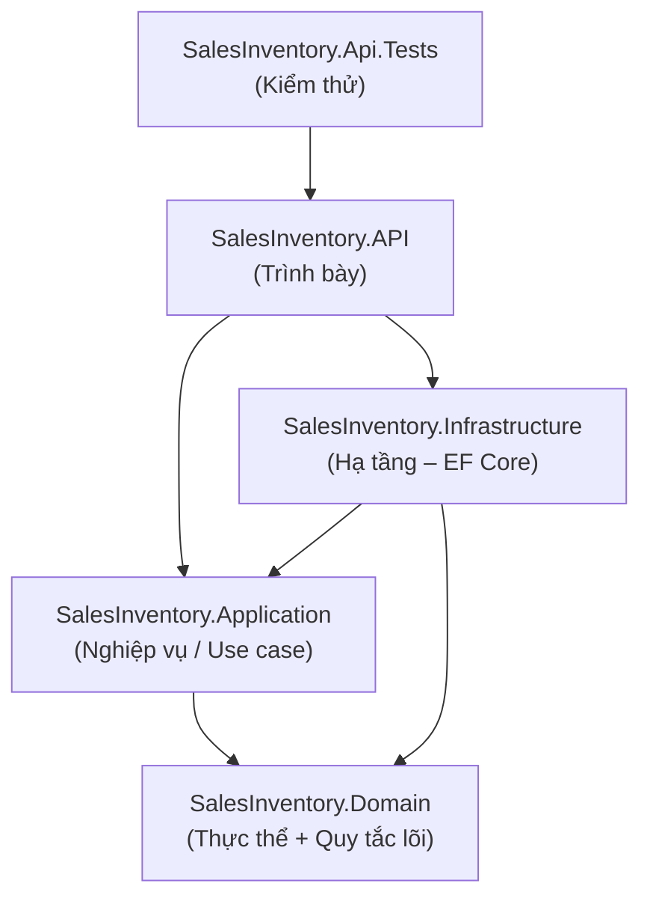

# Cấu trúc Solution – Hệ thống Quản lý Bán hàng & Kho

Solution `SalesInventory.sln` (.NET 8) được tổ chức theo kiến trúc phân lớp (Layered/Clean Architecture) gồm 4 project chính trong `src/` và 1 project kiểm thử trong `tests/`.

## Cây thư mục

```
sales-inventory/
├── SalesInventory.sln
├── global.json                      # ghim .NET SDK 8.0.404
├── docs/
├── src/
│   ├── SalesInventory.API/
│   ├── SalesInventory.Application/
│   ├── SalesInventory.Domain/
│   └── SalesInventory.Infrastructure/
└── tests/
    └── SalesInventory.Api.Tests/
```

## Các project và trách nhiệm

| Project | Tầng | Loại | Trách nhiệm | Tham chiếu tới |
|---|---|---|---|---|
| `SalesInventory.Domain` | Domain (lõi) | Class library | Thực thể nghiệp vụ (Sản phẩm, Danh mục, Đơn hàng, Tồn kho…), value object, enum và các quy tắc nghiệp vụ lõi. Không phụ thuộc framework hay hạ tầng. | *(không có)* |
| `SalesInventory.Application` | Application (nghiệp vụ / use case) | Class library | Các use case và dịch vụ ứng dụng, DTO, validation, và **interface** cho tầng truy cập dữ liệu (repository, unit of work) để Infrastructure hiện thực. | Domain |
| `SalesInventory.Infrastructure` | Infrastructure (hạ tầng) | Class library | Hiện thực các interface của Application: EF Core `DbContext`, cấu hình ánh xạ, migrations, repository, kết nối SQL Server và các dịch vụ bên ngoài. | Application, Domain |
| `SalesInventory.API` | Presentation (trình bày) | ASP.NET Core Web API | Controller / endpoint HTTP, cấu hình DI, middleware, Swagger, xác thực. Là *composition root*: nơi đăng ký Application và Infrastructure vào container. | Application, Infrastructure |
| `SalesInventory.Api.Tests` | Kiểm thử | xUnit | Unit test cho service và integration test cho API. | API |

> **Ghi chú hiện trạng:** Models, `AppDbContext`, Migrations và Services hiện vẫn nằm trong `SalesInventory.API` (code có từ trước). Chúng sẽ được chuyển lần lượt sang Domain, Infrastructure và Application ở các bước sau.

## Sơ đồ phụ thuộc

Mũi tên `A --> B` nghĩa là **A tham chiếu B** (project ngoài tham chiếu project trong). Mọi phụ thuộc đều hướng vào Domain.



## Quy tắc phụ thuộc

1. **Domain** không tham chiếu project nào.
2. **Application** chỉ tham chiếu Domain. Application khai báo interface, còn Infrastructure hiện thực chúng (nguyên lý đảo ngược phụ thuộc – DIP).
3. **Infrastructure** tham chiếu Application và Domain, không bao giờ tham chiếu ngược lại API.
4. **API** tham chiếu Application và Infrastructure. Infrastructure chỉ được dùng để đăng ký DI trong `Program.cs`; controller chỉ làm việc với Application.
5. Không có tham chiếu vòng. Kiểm tra bằng:

```powershell
dotnet list src/SalesInventory.Domain reference
dotnet list src/SalesInventory.Application reference
dotnet list src/SalesInventory.Infrastructure reference
dotnet list src/SalesInventory.API reference
dotnet build SalesInventory.sln
```
